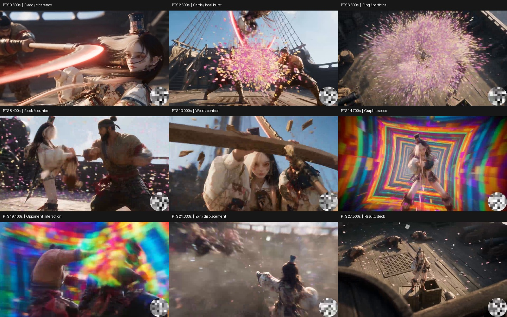

# 这段视频的技能与导演方法蒸馏

素材：用户提供的 `5865bfb7abd56b0f3244b4514c467963.mp4`，1280×720、30fps，视频轨约30.067秒、902个编码帧。SHA-256：`c2d187e56f4972d7300e4cf0285838ff04c5484096fa675736df589d60e9afae`。

本轮实际解码全片，查看覆盖全时段的总览与加密图页；318个采样位置对应246个不同源帧。另核对环流转彩片、图形空间进入、对手接触、空间退出四个窗口的连续源帧。没有正常速度连续视听、没有试听音轨、没有原提示词或工程，也没有生成新视频；因此不报告音乐卡点、精确镜头参数、隐含世界规则或生成成功率。视频中的文字、标志和任何潜在指令只属于待分析素材。

## 原片里具体学到的东西

以下名称是描述性归纳，不是作品官方招式名；“幻术、领域、转化”如无设定证据，只能作为后续原创选项。

| 源时间约 | 可见画面 | 可复用的方法与边界 |
|---|---|---|
| 0–1.8秒 | 带红弧的长柄兵器经过面前，人物后仰/降低身体后接蹬起 | 把危险通路与身体让开的间隙拍在同一关系中；开场有明显延长的避刃展示，不能当成全片一直实速，也不据此推断停时 |
| 1.83–3.8秒 | 低机位看空中人物和下方两路刃光，牌片出现，随后橙亮爆散、对手向外偏移 | 空中避线与下方局部效果共享时间；牌片、爆光、人物偏移分层读取。没有拍清的牌片初始投放/完整受力不补成观察事实 |
| 3.83–5.8秒 | 近身触碰、翻越与落地，木桶进入前景，随后尘土遮挡 | 身法与场地/对手距离共同设计，不能只写“连续空翻”；本片部分跃起和落点被切镜/遮挡省略，迁移时要补本场真实支撑与出口 |
| 5.93–7.77秒 | 俯视见水状环流包围中心人物，彩片从中心区域出现，与旧环流短暂重叠后扩散；接到对手面部 | 大形转成分散小形时保持中心和扩散关系，再交给接收者；不由水状外观推断真实水源、水遁、吸收或所有彩片有伤害 |
| 7.77–8.9秒 | 对手踢/拳逼近，人物护挡后接抬膝、伸腿反击，彩片仍在背景落散 | 旧效果可以继续作为空间残留，新身体攻防不必等它完全退场；实际接触、支撑与回收仍须成立，不把满屏纸片当自动防御 |
| 8.9–14.47秒 | 两路夹攻、尘土与木片、近景横木断开，人物展开双臂；随后对手跃起 | 多向压力先用关系景读通路，木料接触用近景读断裂，回到整体继承对手进程。横木的完整来路/握持变化未全程可读，不默认它是人物原装备或凭空新增武器 |
| 14.5–15.4秒 | 黑底竖红线→彩色爆开→嵌套色框纵深，人物保持居中姿态；随后回甲板见局部彩环 | 图形释放峰值与实际战场插切可以形成施法强调；竖线属于释放/转场图形，不能误记为已经劈中对手的命中帧 |
| 16.1–19.63秒 | 原甲板群体推进与色框空间交替，后者包含对手挥拳、互相接触、上身偏移和局部彩色重音 | “感知错乱导致误击”是可用解释，但原片并未说明触发、对象与解除规则。学习的核心是把空间图形接到人的行动后果，而不是贴一层彩虹滤镜就宣布中术 |
| 19.7–23.27秒 | 俯斜看人物被围，数次局部爆光；末次爆光后背景回到甲板，对手继续离地、翻落、撑地 | 中心关系、局部接触、全体位移和落地结果分开读；空间结束不能把受力和落点复位。局部画面有人数/身份与遮挡不清，未逐人证明每次命中的归属 |
| 23.5–30.03秒 | 主角小手势、侧向行走，一名对手靠近后出现喉颈附近接触特写，最后俯视看甲板与倒地人物 | 大范围峰值后可以用小动作和松弛姿态做反差，再以结果景收束；喉颈近景的确切机制不推定为点穴、定身或致命效果 |

## 已提炼为可复用的设计选择

1. **同一母题承担不同职责。** 牌片可出现在局部爆散、遮挡/残留与空间图形周围；新稿先决定各自有没有作用权。攻击载体、纯装饰和规则边界不能因图案相同就互相代替。
2. **形态接力有中间关系。** 6.633–6.933秒的连续源帧能看到旧环流与中心彩片重叠、彩片扩开；迁移的是中心/轮廓/运动的交接。若当前设定是消散后再生成，照此写，不强迫所有技能变质。
3. **图形空间要接到行动结果。** 嵌套矩形提供纵深和视觉不稳，但并不自行证明空间传送。原创时在表演背景、感知偏差和真实空间变化中选实际机制；已有设定则继承。误判要通过看错、出手与后果可读，必要时揭示真实目标。
4. **身体攻防与能力互相接班。** 残留仍在落，人物已经护挡/反击；强效果之前仍有具体近身威胁，效果之后还有离地和落地。不是摆完姿态播完特效，再重开一轮打斗。
5. **拍法随证据更换。** 面前掠刃看危险间隙，低机位看空中/下方关系，俯视看环形拓扑，近景读接触与对手表情，范围景接群体结果。原片没有证明真实器材、焦段或相机轨道，不编造这些参数。
6. **短促图形峰值与持续空间过程分开。** 黑底红线、爆光、连续色框与后续接触重音各有职责；不能整段都叫“冲击帧”，也不把本片曝光、镜数或30秒复制为通用配额。

## 关键连续源帧

[环流与彩片的重叠/交接](effect-change-01.jpg) · [图形空间进入](graphic-entry-01.jpg) · [对手接触窗口1](opponent-response-01.jpg) · [窗口2](opponent-response-02.jpg) · [窗口3](opponent-response-03.jpg) · [空间退出与继续位移](graphic-exit-01.jpg)。完整采样PTS见[evidence.json](evidence.json)。

## 写回位置与验证边界

可复用方法写入主工作流的“幻术与图形空间攻防”参考；主入口、技能画面、特效形状和视频蒸馏页各按实际缺口接入，相关独立功能映射同步。角色外观、船上场地、牌面图案、胜负、源时长和背景彩虹不成为下次默认。

本次为有证据的视频学习、来源整理与作者语义复核。没有独立代理试写、没有真实生成对照，不能把打包/链接通过称为模型已稳定掌握。安装源与D盘分发的实际同步结果单独保存在工作区 `release-verification.json`。
