# Getting Started Guide

**Welcome to Midjourney, your portal to transforming text into amazing images and videos! If you're ready to unleash your creativity, this guide is your first step to crafting stunning creations and exploring endless possibilities.**

## Subscribing to Midjourney

Before you dive into creating your first masterpiece, you'll need to subscribe to one of our plans. Here's how you can get started:

- Log in to midjourney.com: [Logging In & Connecting Accounts](https://docs.midjourney.com/hc/en-us/articles/33390994570509)
- Select a plan: [Comparing Midjourney Plans](https://docs.midjourney.com/hc/en-us/articles/27870484040333)
- Subscribe: [How to Subscribe](https://docs.midjourney.com/hc/en-us/articles/31974654274573)

## Making Your First Image

**Video tutorial:** Watch this quick [video tutorial on making your first image](https://youtu.be/jDexcrChwRc?si=lEjLAuj_D1IixMaU) below.

<video controls preload="metadata" src="assets/jDexcrChwRc.mp4" width="100%"></video>

*Start Here: Making your First Image · 6:46 · 本地文件 `assets/jDexcrChwRc.mp4` · [英文逐字稿](<Midjourney 入门视频文字稿.md>)*

1. **Visit your Create page:** Go to the [Create page](https://www.midjourney.com/imagine) on midjourney.com. This is where your images come to life, and you can see them appear in real-time.
2. **Use the Imagine bar:** At the top of the page, you'll see the Imagine bar. Here, type what you'd like to see—this is your prompt.

   

3. **Generate your images:** After pressing Enter or the send button if you're using a mobile device, Midjourney creates a set of four images. Watch as your images take form.
4. **Congratulations!** Once it reaches 100%, you're done! You've created your first Midjourney images.

Writing and crafting prompts can be an art in and of itself. To learn more, check out our [Prompt Basics](https://docs.midjourney.com/hc/en-us/articles/32023408776205) and [Art of Prompting](https://docs.midjourney.com/hc/en-us/articles/32835253061645) articles.

## Personalize Midjourney

Midjourney is even better with Personalization. Create [moodboards](https://docs.midjourney.com/hc/en-us/articles/39193335040013) and custom [Personalization profiles](https://docs.midjourney.com/hc/en-us/articles/32433330574221) that will help Midjourney generate images that uniquely match your individual style!

## Continue Working on Your Images

The creativity doesn't stop here! Learn how to enhance and refine your creations using upscalers, variations, zoom out, pan, Editor, and more in our [Modifying Your Creations](https://docs.midjourney.com/hc/en-us/articles/33329329805581) article.

## Turn Images into Videos

Make your images come alive by transforming them into videos! Learn how to animate both your Midjourney creations and your own images on our [Video](https://docs.midjourney.com/hc/en-us/articles/37460773864589) article.

## Customizing Your Settings

You can change your default generation settings at any time by clicking on the settings icon  in the Imagine bar.

For more information on each setting, check out these articles: [Aspect Ratio](https://docs.midjourney.com/hc/en-us/articles/31894244298125), [Raw](https://docs.midjourney.com/hc/en-us/articles/32634113811853), [Version](https://docs.midjourney.com/hc/en-us/articles/32199405667853), [Draft Mode](https://docs.midjourney.com/hc/en-us/articles/35577175650957), [Stylize](https://docs.midjourney.com/hc/en-us/articles/32196176868109), [Weird](https://docs.midjourney.com/hc/en-us/articles/32390120435085), [Variety](https://docs.midjourney.com/hc/en-us/articles/32099348346765), [GPU Speed](https://docs.midjourney.com/hc/en-us/articles/32016412137741), [Stealth](https://docs.midjourney.com/hc/en-us/articles/32019750070669), [Video Resolution](https://docs.midjourney.com/hc/en-us/articles/37460773864589), and [Video Batch Size](https://docs.midjourney.com/hc/en-us/articles/37460773864589-Video#h_01K2J07NWY2CTEWHAVCAPQJFZV).

## Using Images in Your Prompts

Did you know that you can also provide Midjourney with images—not just text—to guide your creations?

- [Starting Frame](https://docs.midjourney.com/hc/en-us/articles/37460773864589) lets you create a video from your image.
- [Image Prompts](https://docs.midjourney.com/hc/en-us/articles/32040250122381) let you influence content, composition, style, and colors.
- [Style References](https://docs.midjourney.com/hc/en-us/articles/32180011136653) help you match the look and feel of another image.
- The [Edit Model](https://docs.midjourney.com/hc/en-us/articles/48495453462797) allows you to use images and plain text instructions to create or modify images.

**Video tutorial:** Watch this quick [video tutorial on using images](https://youtu.be/lEKeShkzKnE?si=umKfUjroX9mCeZIr) below.

<video controls preload="metadata" src="assets/lEKeShkzKnE.mp4" width="100%"></video>

*Using images in your prompts · 7:21 · 本地文件 `assets/lEKeShkzKnE.mp4` · [英文逐字稿](<Midjourney 入门视频文字稿.md>)*

For more information about all the tools and features available on your Create page, check out our [Creating on Web](https://docs.midjourney.com/hc/en-us/articles/33390732264589) article.

## Organizing Your Creations

Your Organize page offers a clear view of all your Midjourney creations. Here, you can download, sort, and filter your creations. You can also organize them into folders easily. For more tips and tricks, check out our [Organizing Your Creations](https://docs.midjourney.com/hc/en-us/articles/33329462451469) article.

## Community Guidelines

To ensure a safe and happy creative environment, stay informed about our [Community Guidelines](https://docs.midjourney.com/hc/en-us/articles/32013696484109).

## Sharing & Support

Feel like sharing your works of art? Connect with our community and seek guidance from fellow Midjourney enthusiasts or our helpers in [our Discord server](https://discord.gg/midjourney).

If you need help with your account or subscription, you can browse helpful [billing articles](https://docs.midjourney.com/hc/en-us/categories/16016577793421) or [contact our billing team](https://docs.midjourney.com/hc/en-us/articles/32638309968141).

---

原文：[Getting Started Guide – Midjourney Docs](https://docs.midjourney.com/hc/en-us/articles/33329261836941-Getting-Started-Guide)
正文、图片、视频均取自该页面；图片与两个 YouTube 视频已下载至本目录 `assets/`，离线可读。抓取时间：2026-11-05。
