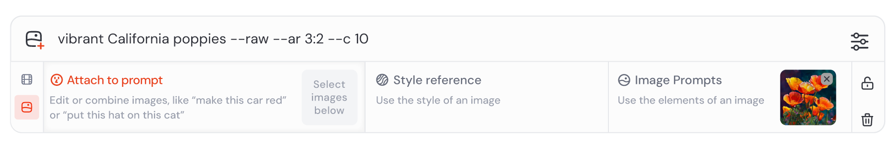

# Prompt Basics

> 来源：https://docs.midjourney.com/hc/en-us/articles/32023408776205
> 抓取时间：2026-11-05

---

### A prompt is your creative starting point—learn how to turn words into unique and exciting images!

## What is a Prompt?

Creating with Midjourney starts with a prompt. A prompt is simply the text or phrase you use to tell Midjourney what kind of image or video you want.

Your prompt could be just one word or a complete phrase. The more thought you put into your prompt, the more unique and interesting your creation can be. So, take a moment to think about what you want to see, and use your words to guide the creative process.

## Prompting Tips & Tricks

Short and simple prompts typically generate the best images with Midjourney. Use phrases that clearly describe what you want to see. Think of it like giving a quick snapshot of your idea. Avoid making long lists or detailed instructions; these can confuse the process.

** **Show me a picture of lots of blooming California poppies, make them bright, vibrant orange, and draw them in an illustrated style with colored pencils

** **Colored pencil illustration of bright orange California poppies

#### Choose the Right Words

The words you pick matter! Try using specific synonyms. For example, instead of "big," consider "huge," "gigantic," or "enormous." Being precise can help get better results.

#### Be Specific with Numbers

Plural words like "cats" can be vague. Instead, use specific numbers like "three cats." Or go for collective nouns like "flock of birds" instead of just "birds."

#### Focus on What You Want

Describe what you do want instead of what you don’t. If you mention a party with “no cake,” a cake might still appear. For excluding items, read about the [no parameter](https://docs.midjourney.com/hc/en-us/articles/32173351982093).

#### Prompt Length and Details

Your prompts can be simple—even a single word or emoji works. Short prompts let the default Midjourney style fill in the gaps. But if specific elements are important to you, be sure to include them. Fewer details mean more variety, but you get less control over the outcome.

Be clear about details that matter to you. Here are some areas to consider:

## Advanced Prompts

Once you're comfortable with basic prompts, start exploring more advanced options! Add one or more [Image Prompts](https://docs.midjourney.com/hc/en-us/articles/32040250122381), use multiple text phrases, and apply tools called [parameters](https://docs.midjourney.com/hc/en-us/articles/32859204029709). These give you the ability to create more complex or specific images. Experiment by mixing different elements to boost your creativity!

Text Prompt

Image Prompts

Image Prompts

Style References

Edit Model References

Parameters

Parameters

aspect ratios

## More Prompt Help

Midjourney has a vibrant community that loves problem-solving and helping others! If you need more help or tips, make sure to visit our [Prompt Craft channel on Discord](https://discord.com/channels/662267976984297473/992207085146222713).

Need Help Getting Started?

Getting Started Guide
