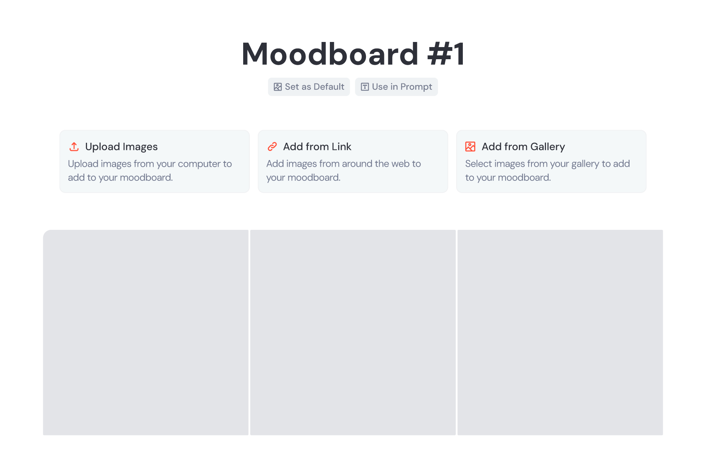
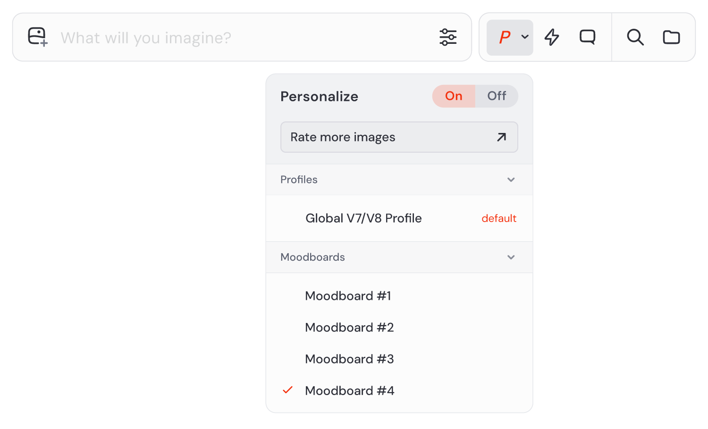
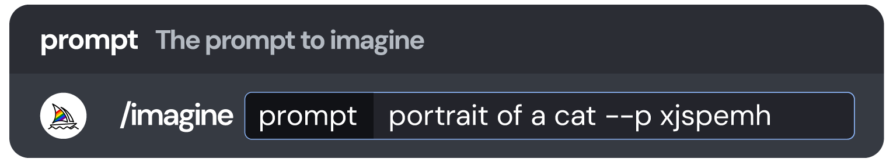
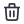

# Moodboards

> 来源：https://docs.midjourney.com/hc/en-us/articles/39193335040013
> 抓取时间：2026-11-05

---

### Use curated images to develop a unique style with Moodboards.

> For more information about V8.2, see our [Version](https://docs.midjourney.com/hc/en-us/articles/32199405667853) article.

## What are Moodboards?

Moodboards are a type of Midjourney [personalization](https://docs.midjourney.com/hc/en-us/articles/32433330574221-Personalization) that lets you select specific images to create a unique style for your Midjourney projects.

Moodboards help you express and communicate your vision across a wider aesthetic range, especially compared to [Style References](https://docs.midjourney.com/hc/en-us/articles/32180011136653-Style-Reference), which are more specific. It's all about showing Midjourney what you imagine, when words just aren't enough.

Moodboards are compatible with Midjourney [versions](https://docs.midjourney.com/hc/en-us/articles/32199405667853-Version) 6 and later, but cannot be used with Style Reference Version (`--sv`) or Style Weight (`--sw`).

**Video tutorial:** Watch this quick [video tutorial on Moodboards](https://youtu.be/r0E1rf89FNM?si=EQgu-STGn4LYwLkq) below.

<video controls preload="metadata" src="../assets/videos/v_r0E1rf89FNM.mp4" width="100%"></video>

*视频教程 · 2:53 · 本地文件 `assets/videos/v_r0E1rf89FNM.mp4`*

## Creating Moodboards

Access Moodboards by visiting the  [Moodboards Page](https://www.midjourney.com/moodboards) from the main website navigation menu.

You can create multiple moodboards, each with a different style. Each moodboard has a unique ID that generates a code when used in your prompts.

Use the  New Moodboard button to create a new moodboard.

You can give your moodboard a name and add images to it by uploading them from your device, providing image URLs, or selecting images from your Midjourney gallery.

## Using Moodboards

**On Web**

The Personalization  button next to the Imagine bar allows you to turn Personalization on or off, and select your default moodboards. When on, your default selections will automatically be added to all your prompts.

Click the  button to turn Personalization on (the icon will change color) and use the dropdown arrow to select your default moodboards (you can use one or multiples).

You can also add `--p` to the end of your prompt in the Imagine bar to apply your default moodboard to your prompt.

To use a specific moodboard, copy its ID from your [Moodboards Page](https://www.midjourney.com/moodboards) with the use  icon and add it to the end of your prompt (example: `--p mID`). You can also use a specific code `--p code` from a previous prompt.

**In Discord**

Add `--p` to the end of your prompt in Discord. This will automatically apply your default profiles to your prompt.

To use a specific moodboard, copy its ID from your [Moodboards Page](https://www.midjourney.com/moodboards) with the use  icon and add it to the end of your prompt (example: `--p mID`). You can also use a specific code `--p code` from a previous prompt.

You can also use the `🙋 Personalization` button in your Midjourney [settings](https://docs.midjourney.com/hc/en-us/articles/32868982949517) to automatically add the `--p` parameter to all your prompts.

## Moodboard Codes

Your moodboards can grow and change if you add or remove images. As your moodboard updates, it will generates new codes that act like labels for the different versions.

Copy the ID from your moodboard to use the latest version. To find older codes, you can revisit your previous prompts to see the codes you used before.

Note: When using a moodboard ID it will automatically convert from `--p mID` to `--p code` when you submit your prompt.

## Managing Your Moodboards

You can manage your moodboards by renaming or deleting them. To do this, click the three dots icon and use the pencil  button to rename it or the trash can  button to delete it.

When you delete a moodboard it disappears from your moodboard list, and you won't be able to add any new images to it. However, any codes that were already created from that moodboard will still work, allowing you to continue using its style in future prompts.

Click the use  icon to add the moodboard parameter to your prompt in the Imagine bar.

The "Select" button lets you select which boards are used by default when Personalization is turned on. You can select more than one, including [image ranking profiles](https://docs.midjourney.com/hc/en-us/articles/32433330574221-Personalization).

## Stylize with Moodboards

When using Moodboards, the [stylize parameter](https://docs.midjourney.com/hc/en-us/articles/32196176868109) controls how much of your moodboard style is applied to the image. A lower stylize value will limit the style, while a higher value will increase it. The stylize parameter accepts values from 0 to 1000. The default is 100.

Need Help Getting Started?

Getting Started Guide
