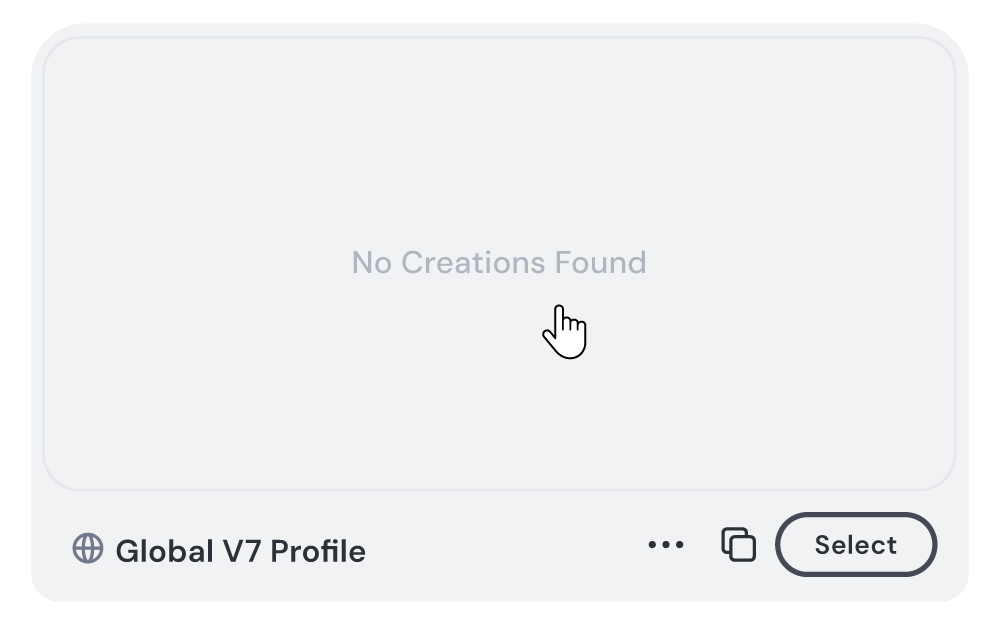
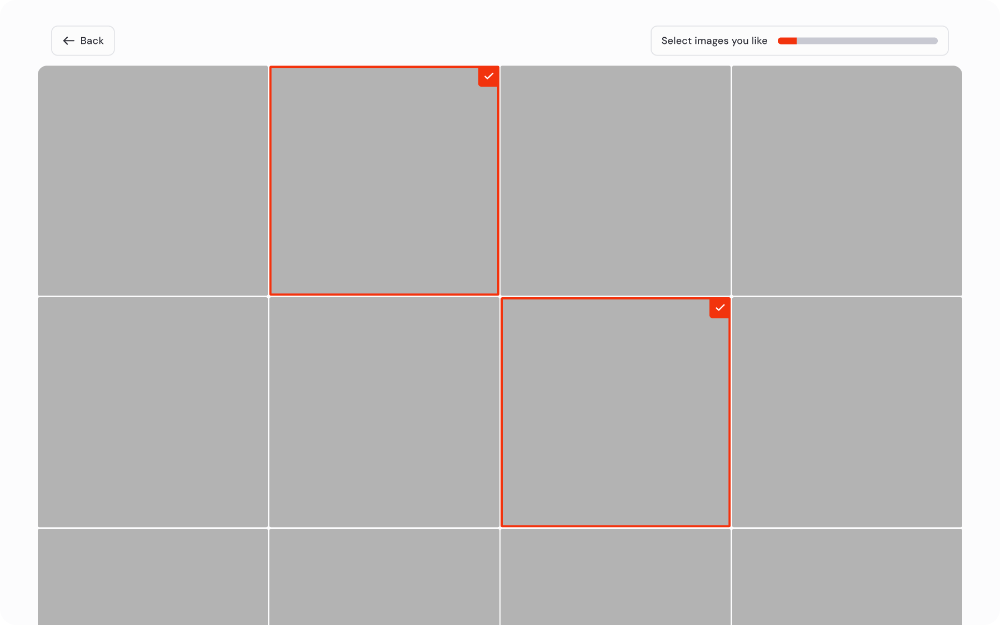
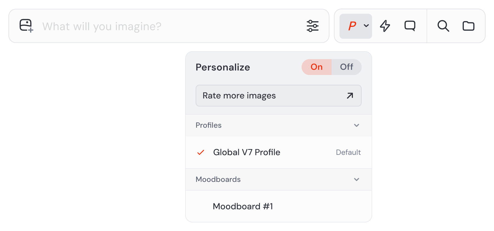
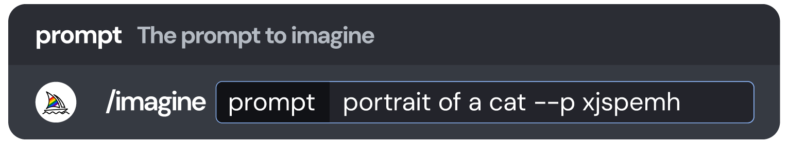

# Personalization

> 来源：https://docs.midjourney.com/hc/en-us/articles/32433330574221
> 抓取时间：2026-11-05

---

### Create custom image styles with Personalization profiles using `--p`

> Your V7 Global Personalization Profile is compatible with V8.2. For more information about V8.2, see our [Version](https://docs.midjourney.com/hc/en-us/articles/32199405667853) article.

## What is Personalization?

Personalization acts like a style assistant for your image creations. By liking or selecting images, Midjourney gets to know what kind of aesthetics you love and uses that information to generate images tailored to your personal tastes and unique style.

Personalization is compatible with Midjourney [versions](https://docs.midjourney.com/hc/en-us/articles/32199405667853) 6 and later.

To create a style using a specific collection of images, check out our [Moodboards](https://docs.midjourney.com/hc/en-us/articles/39193335040013) article.

## Unlocking Personalization

Unlocking your Global Personalization Profile is the first step to using Personalization.

**Here’s how to unlock your Global Profile:**

1. Visit the  [Personalize page](https://www.midjourney.com/personalize) and find your Global V7 Profile.

2. Click the thumbnail area of the profile.

3. You’ll see a grid of images. Click on the images you like the best.

4. Scroll down and keep picking your favorites.

5. As you choose, watch the progress bar move at the top of the page. Once you’ve selected enough images, your Global Profile will unlock.

To get the most out of your Personalization profiles, we recommend spending more time selecting images. The more images you pick, the better Midjourney gets at tailoring the images to your style.

> You can now create additional profiles for V8.X, however there is currently no Global V8 Profile. Your Global V7 Profile works in V8.1 and V8.2. V8 profiles are currently not compatible with V7.

## Using Personalization

**On Web**

Click the Personalization button next to the Imagine bar to turn Personalization on or off (the icon will change color). Use the dropdown arrow to select your default Personalization profiles. When on, your defaults will automatically be added to all your prompts.

You can also add `--p` to the end of your prompt in the Imagine bar to apply your default Personalization profiles to your prompt.

To use a specific Personalization profile, copy its ID from your [Personalize page](https://www.midjourney.com/personalize) with the  use icon and add it to the end of your prompt (example: `--p pID`). You can also use a specific code `--p code` from a previous prompt.

**In Discord**

Add `--p` to the end of your prompt in Discord. This will automatically apply your default Personalization profiles to your prompt.

To use a specific Personalization profile, copy its ID from your [Personalize page](https://www.midjourney.com/personalize) with the  use icon and add it to the end of your prompt (example: `--p pID`). You can also use a specific code `--p code` from a previous prompt.

You can also use the `🙋 Personalization` button in your Midjourney Discord [settings](https://docs.midjourney.com/hc/en-us/articles/32868982949517) to automatically add the `--p` parameter to all your prompts.

> You'll only be able to use Personalization once you've unlocked your Global Profile. If you try to use `--p` without unlocking, you'll see an error message.

**Video tutorial:** Watch this quick [video tutorial on Personalization](https://youtu.be/Fwj_QpC0DxA?si=vYgyBFIFAqz41BoK) below.

<video controls preload="metadata" src="../assets/videos/v_Fwj_QpC0DxA.mp4" width="100%"></video>

*视频教程 · 3:48 · 本地文件 `assets/videos/v_Fwj_QpC0DxA.mp4`*

Note: Rating image pairs has been replaced with selecting images from a grid.

## Personalization Profiles

Create and manage your Personalization profiles on the [Personalize page](https://www.midjourney.com/personalize) from the main website navigation menu.

You can create multiple Personalization profiles, each with a different style or look. Each one has a unique ID that generates a code when used in your prompts.

####  Global Profile

This is your default profile, and you'll need to unlock it by selecting images before you can create additional Personalization profiles.

 Liking images from other members on the Explore page will influence your Global Profiles. Check which version the liked image was made with to see which Global Profile it will affect.

#### Additional Profiles

You can create extra Personalization profiles to focus on specific styles or different aesthetics than your Global Profile by clicking the  New Profile button. New Personalization profiles will be based on your default [version](https://docs.midjourney.com/hc/en-us/articles/32199405667853) setting, so if you want to create a new V6 Personalization profile, make sure V6 is set as your default version in your  settings.

If you Rank Image Aesthetics from the [Tasks page](https://www.midjourney.com/tasks), this information will automatically apply to your Global Profile. To personalize a different one, locate it on your [Personalize page](https://www.midjourney.com/personalize) and click its name.

## Personalization Codes

Your Personalization profiles can grow and change as you keep liking and selecting more images. As it updates, it will generate new codes that act like labels for the different versions.

Copy the ID from your Personalization profile to use the latest version. To find older codes, you can use the `/list_personalize_codes` command in Discord or revisit your previous prompts to see the codes you used before.

Note: When using a Personalization profile ID it will automatically convert from `--p pID` to `--p code` when you submit your prompt.

## Managing Your Personalization Profiles

You can manage your Personalization profiles by renaming or deleting them. To do this, click the three dots icon and use the pencil  button to rename it or the trash can  button to delete it.

When you delete a Personalization profile it disappears from the list, and you won't be able to add any new data to it. However, any codes that were already created will still work, allowing you to continue using its style in future prompts.

Note: You cannot delete Global Profiles.

Click the use  icon to add the `--p pID` parameter to the Imagine bar.

The Select button lets you pick which Personalization profiles are used by default when Personalization is turned on.

## Stylize with Personalization

When using Personalization, the [stylize parameter](https://docs.midjourney.com/hc/en-us/articles/32196176868109) controls how much of your Personalization is applied to the images. A lower stylize value will limit the Personalization, while a higher value will increase it. The stylize parameter accepts values from 0 to 1000. The default is 100.

Need Help Getting Started?

Getting Started Guide
