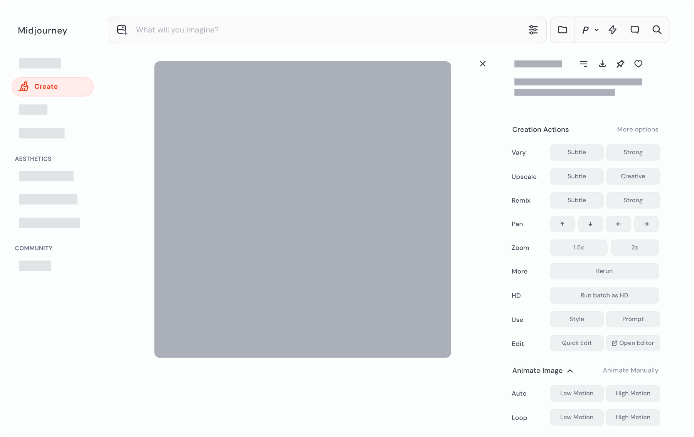

# Modifying Your Creations

> 来源：https://docs.midjourney.com/hc/en-us/articles/33329329805581
> 抓取时间：2026-11-05

---

### You've generated your first Midjourney image—now what? Learn about our tools for modifying your images!

Once you've made an image with Midjourney, your creative journey doesn't have to stop there. You have a range of tools at your fingertips to modify and enhance your images.

To get started, click on your image from your Create or Organize Page to open it and reveal more options. Here's a quick look at the Creation Actions.

*If any of the Creation Actions buttons are missing, just click "More options" and add a checkmark to make them visible.*

## The Edit Model

The [Edit Model](https://docs.midjourney.com/hc/en-us/articles/48495453462797) is a powerful tool that allows you to make modifications to your images using plain language instructions, and use reference images to achieve things like character consistency (it replaces [Omni Reference](https://docs.midjourney.com/hc/en-us/articles/36285124473997) and Character Reference in V8.X).

## Variations

[Variations](https://docs.midjourney.com/hc/en-us/articles/32692978437005) (Vary) in Midjourney let you create multiple versions of your image with subtle or strong differences. This is particularly useful when you’re happy with your original image but are curious about changes that could make it even better.

## Upscale

[Upscaling](https://docs.midjourney.com/hc/en-us/articles/32804058614669) takes your SD image to the next level by enlarging its dimensions. Creative Upscale not only boosts the size but also adds subtle improvements, perfect for when your image needs that extra polish. To enlarge your image without altering it, use Subtle Upscale.

## Remix

Remix is a feature that lets you make iterations on your image by changing the prompt text. With Remix, you have the freedom to change both the prompt and the parameters you've set, allowing you to creatively steer how your images develop. Remix works a bit different on our website than on Discord, so be sure to check out our [Remix](https://docs.midjourney.com/hc/en-us/articles/32799074515213) article.

## The Editor

The Midjourney [Editor](https://docs.midjourney.com/hc/en-us/articles/32764383466893) includes Pan, Zoom Out, and Vary Region (the erase tool) all in one interface, if you'd like to make several changes at once. You can also use the individual tools on their own.

#### Pan

With [Pan](https://docs.midjourney.com/hc/en-us/articles/32570788043405), you can expand the canvas of your image in a specific direction to add more content and change its [aspect ratio](https://docs.midjourney.com/hc/en-us/articles/31894244298125).

#### Zoom Out

[Zoom Out](https://docs.midjourney.com/hc/en-us/articles/32595476770957) gives you the ability to add more context and elements around all four sides of your original image, effectively expanding it beyond its current borders.

#### Inpainting

[Vary Region](https://docs.midjourney.com/hc/en-us/articles/32794723105549)/[Erase](https://docs.midjourney.com/hc/en-us/articles/32696720371341) is perfect for editing specific parts of your image, allowing for precise alterations without changing the rest of the image.

## Use in a New Prompt

Under Creation Actions on our website you also have the "Use" buttons which allow you to quickly and easily use your generated image as an [Image Prompt](https://docs.midjourney.com/hc/en-us/articles/32040250122381), [Style Reference](https://docs.midjourney.com/hc/en-us/articles/32180011136653), or add the prompt text to your Imagine bar to make changes and run the prompt again.

## Animate

The animate tools give you the ability to turn your image into a captivating 5 second video. Use the Auto buttons to jump right in, or the Manual buttons to adjust your prompt text for the video. Learn more on our [Video](https://docs.midjourney.com/hc/en-us/articles/37460773864589) article.

Need Help Getting Started?

Getting Started Guide
