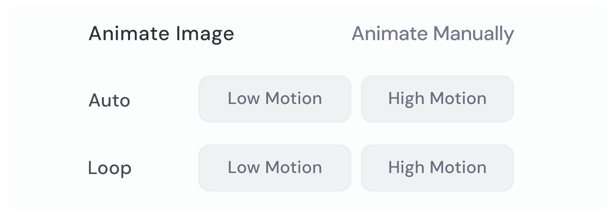
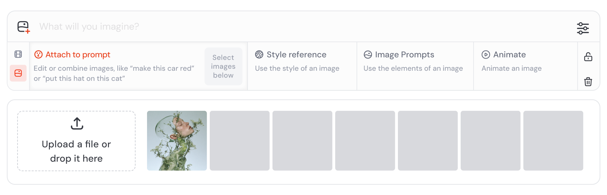
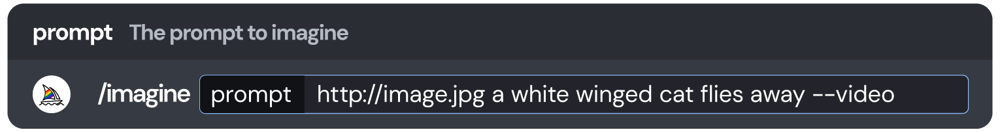
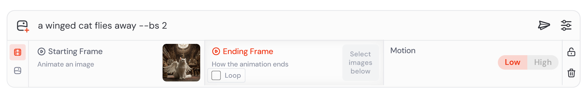
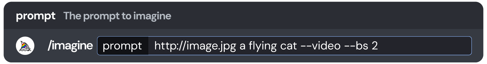
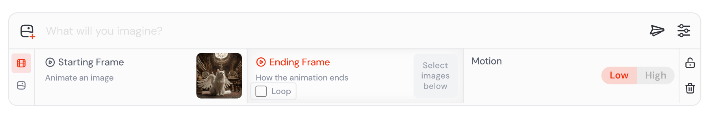
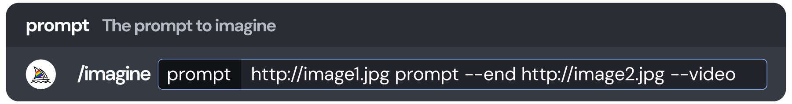

# Video

> 来源：https://docs.midjourney.com/hc/en-us/articles/37460773864589
> 抓取时间：2026-11-05

---

### Turn your images into captivating 5 second videos using Midjourney!

Welcome to the exciting world of video creation with Midjourney! You can now turn a single image into a dynamic 5-second video.

It's as simple as feeding Midjourney an image to serve as the first frame, adding a text prompt (optional), and then watch as it brings your vision to life with a moving sequence.

> • All plan tiers can generate videos in Fast Mode, but only Pro and Mega plans can generate videos in Relax Mode (SD resolution only).
> • Standard, Pro, and Mega plans can generate HD resolution videos, but only in Fast Mode.
> • Videos cost more [GPU time](https://docs.midjourney.com/hc/en-us/articles/32016412137741) compared to regular images. For a detailed breakdown of costs, see the Batch Size section below.
> • Video generations are only compatible with video-specific parameters: `--motion low`, `--motion high`, `--raw`, `--loop`, `--end`, and `--bs #`.

**Video tutorial:** Watch this quick [tutorial on video creation](https://youtu.be/EhrW1wGYZv0?si=FVsn2WhaK0HqQqar) below.

<video controls preload="metadata" src="../assets/videos/v_EhrW1wGYZv0.mp4" width="100%"></video>

*视频教程 · 5:30 · 本地文件 `assets/videos/v_EhrW1wGYZv0.mp4`*

## Generating Videos

**On Web**

Head to [midjourney.com](https://www.midjourney.com/imagine) to start creating videos! If you need help accessing our website, check out our [Logging In & Connecting Accounts](https://docs.midjourney.com/hc/en-us/articles/33390994570509-Logging-In-Connecting-Accounts) article.

**If you use Midjourney via Discord, please make sure you log in using the "Continue with Discord" option.**

All images in your gallery (regardless of what [version](https://docs.midjourney.com/hc/en-us/articles/32199405667853-Version) they were made in) now have Animate Image buttons below the Creation Actions section when you open them. You'll also see a shortcut button when you hover your mouse over them from the Create page.

The **Animate Manually** link will give you an opportunity to adjust the text prompt in the Imagine bar before generating the video.

The **Auto** buttons will automatically start generating a video using your image.

The **Loop** buttons will automatically start generating a looping video using your image (meaning the starting frame and ending frame are the same image).

For information on "Low Motion" and "High Motion" check out the Video Motion section below.

Note: Any image [parameters](https://docs.midjourney.com/hc/en-us/articles/32859204029709-Parameter-List) used to generate your original image will be automatically removed when generating videos.

To select an image to animate, start by clicking on the image icon  in the Imagine bar. This opens the images panel, allowing you to upload new images or pick from those you've already uploaded.

Drag and drop your image into the Animate section. To remove your image from the Imagine bar, hover your mouse over it and click the X icon.

If you want to use your images with multiple prompts, click the lock icon  to keep your images pinned to the Imagine bar.

**Other Image Reference Types (not compatible with video generations):**
 [Edit Model Reference](https://docs.midjourney.com/hc/en-us/articles/48495453462797) (Attach to prompt)
 [Style Reference](https://docs.midjourney.com/hc/en-us/articles/32180011136653)
 [Image Prompt](https://docs.midjourney.com/hc/en-us/articles/32040250122381-Image-Prompts)

**In Discord**

After your image is generated, use the `U1` `U2` `U3` `U4` buttons to separate your favorite image from the initial grid.

Once separated, use the `Animate (High motion)` or `Animate (Low motion)` buttons to generate a video. If you have [Remix Mode](https://docs.midjourney.com/hc/en-us/articles/32799074515213-Remix) turned on, you can edit the prompt text before submitting the video prompt.

Note: In Midjourney versions 5 and later the `U#` buttons separate your image from the grid but do not change its size, so they do not consume [GPU time](https://docs.midjourney.com/hc/en-us/articles/32016412137741). In earlier versions these buttons do increase your image size, and will consume GPU time.

Don't see the Animate buttons? If you have upscales in Discord that were made before the release of video generations, you can use the [show command](https://docs.midjourney.com/hc/en-us/articles/32635695384461) to refresh the buttons.

To generate a video using your own image, paste your image URL at the beginning of your prompt and then add the `--video` parameter to the end of your prompt. A text prompt is optional.

It's important to ensure that you have a valid image URL, meaning the image should already be online. If your image is stored on your computer or device, you can [host it on Discord](https://docs.midjourney.com/hc/en-us/articles/32558957919117) to generate an image URL.

**External Image Rules & Requirements**

Midjourney provides you with powerful tools for unleashing your imagination. When using our tools to create with external images, we have additional necessary precautions you should be aware of.

By using external images with Midjourney, you agree to the following rules in addition to our [Terms of Service](https://docs.midjourney.com/hc/en-us/articles/32083055291277).

- You must meet the age requirement in our [Terms of Service](https://docs.midjourney.com/hc/en-us/articles/32083055291277).

- You must follow all applicable laws, our [Community Guidelines](https://docs.midjourney.com/hc/en-us/articles/32013696484109), and other policies.

- We may remove content or restrict access at our discretion.

- You are responsible for all content you input, create, and share.

- You must have the necessary rights to use the images you upload.

- Do not manipulate images of public or private individuals in ways that are abusive, disrespectful, offensive, derogatory, or inflammatory—this includes sexualized deepfakes.

- Anyone attempting to violate our [Community Guidelines](https://docs.midjourney.com/hc/en-us/articles/32013696484109) will face suspension or banning without refund. Use these tools with respect and consideration for others.

**If you disagree with these rules, do not use Midjourney with external images.**

You will likely encounter friction with our moderation — seemingly innocent prompts may be blocked by our filters. Blocked jobs don't cost you any credits. [GPU time](https://docs.midjourney.com/hc/en-us/articles/32016412137741) will only be deducted when you see your results.

We encourage you to use this tool and your imagination with joy, wonder, responsibility, and respect.

For additional information on policies, including privacy, payments, and disputes, refer to our [Terms of Service](https://docs.midjourney.com/hc/en-us/articles/32083055291277).

## Batch Size

By default Midjourney will generate 4 videos from each video prompt. If you want to conserve [GPU time](https://docs.midjourney.com/hc/en-us/articles/32016412137741), you can choose to generate only 1 or 2 videos from each prompt instead. Batch sizes work in both Fast and Relax Mode.

**On Web**

Add `--bs #` to the end of your prompt in the Imagine bar. You can use 1, 2, or 4.

You can choose a default batch size for all your video prompts in the settings panel. To do this, click the settings  button in the Imagine bar and set the Video Batch Size under More Options. Once you set it, this will apply to all your future video prompts.

**In Discord**

Add `--bs #` to the end of your prompt in Discord. You can use 1, 2, or 4.

## Extend Video

Video generations start at 5 seconds, but it doesn't have to stop there. After your video is created, you’ll see options to extend it further. This will add another 4 seconds to your video.

Feel free to extend your video up to 4 times, until it reaches 21 seconds, which is the maximum length available.

Extending a video costs the same amount of [GPU time](https://docs.midjourney.com/hc/en-us/articles/32016412137741) as an initial video generation.

**On Web**

- **Extend Auto:** This button extends your video automatically, using the original prompt.

- **Extend Manual:** Use the manual option if you’d like to change your prompt text before extending the video. This way, you can tweak or add new elements before submitting for the longer video.

**In Discord**

## Looping & End Frames

After selecting an image to use as your starting frame, you also have the option to set an ending frame. You can reuse the starting frame to create a looping video, or add a different image as your ending frame.

**On Web**

Once you add an image to the Starting Frame section of the Imagine bar, some additional video options will appear.

If you want to re-use the starting frame as your end frame (this will create a looping video), use the "Loop" checkbox in the Ending Frame section.

To use a different image as your ending frame, add it to the Ending Frame section.

**In Discord**

If you want to re-use the starting frame as your end frame (this will create a looping video), add `--loop` to the end of your video prompt.

To use a different image as your ending frame, add the `--end` parameter to your video prompt and paste your image URL.

It's important to ensure that you have a valid image URL, meaning the image should already be online. If your image is stored on your computer or device, you can [host it on Discord](https://docs.midjourney.com/hc/en-us/articles/32558957919117) to generate an image URL.

## Video Motion

When generating videos, you have two motion settings options to choose from, "Low Motion" and "High Motion." Use the corresponding buttons, or add the `--motion low` or `--motion high` parameters to the end of your video prompt.

You can also change your default motion setting by loading an image into the Starting Frame section of the Imagine bar and toggling the settings in Motion Amount.

## Video Raw

For more precise motion control of your video creations, using the `--raw` parameter in your video prompts can be helpful. This feature works similarly to [Raw Mode](https://docs.midjourney.com/hc/en-us/articles/32634113811853-Raw-Mode) for images.

When you add `--raw`, it reduces the extra creative flair that Midjourney usually adds, allowing your prompt text to have more influence on the outcome.

## Video Resolution

Midjourney videos are generated in 480p quality, also called Standard Definition (SD). If you have the Standard, Pro, or Mega plan you can also generate videos in 720p quality, or High Definition (HD), by adjusting your Video Resolution under More Options in the settings  panel of the Imagine bar .

The exact shape and size of your video is based on the aspect ratio of your starting image. If you upload your generated video to another video-sharing platform, the quality will be classified as 480p or 720p.

The table below shows how different starting image aspect ratios will affect your video's pixel dimensions:

*Midjourney may need to adjust the aspect ratio slightly in some cases. This means that your video's aspect ratio may be a little different than your starting image.

## Video Playback on Web

Once your videos have finished generating on the Create page, hover your mouse over them to play them.

You can also manually scrub (play the videos at your own speed) by holding the Control or Command key on your keyboard and moving your mouse back and forth over them.

## Downloading Videos

When you right-click on a video from your Create or Organize page, you'll see three download options:

Downloading videos from Discord will download the raw video file.
