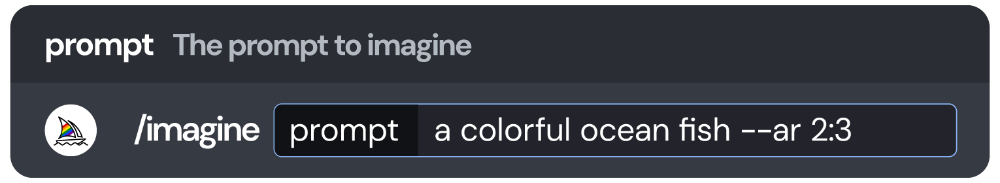

# Aspect Ratio

> 来源：https://docs.midjourney.com/hc/en-us/articles/31894244298125
> 抓取时间：2026-11-05

---

### Midjourney images start as squares, but you can change this using the aspect ratio parameter: `--ar` or `--aspect`

> For more information about V8.2, see our [Version](https://docs.midjourney.com/hc/en-us/articles/32199405667853) article.

## What is Aspect Ratio?

Aspect ratio is a way to describe how wide and tall an image is. It's shown as two numbers, like 1:1 or 4:3, that tell you how the width compares to the height. For example, a 4:3 aspect ratio means the width is 4 parts, and the height is 3 parts.

By default Midjourney images are square, meaning the width and height are the same, so the aspect ratio is 1:1.

Choosing an aspect ratio helps you decide if your image will be wide (landscape) or tall (portrait). Use a bigger first number for a wide image and a bigger second number for a tall image.

Important: Aspect ratio isn't the same as image dimensions. The final size of your Midjourney images will also depend on the [version](https://docs.midjourney.com/hc/en-us/articles/32199405667853) and [upscaler](https://docs.midjourney.com/hc/en-us/articles/32804058614669) you're using.

## Setting the Aspect Ratio

**On Web**

Add `--ar #:#` to the end of your prompt in the Imagine bar.

You can choose a default aspect ratio for all your images in the settings panel. To do this, click the settings  button in the Imagine bar. Once you set it, this will apply to all your future prompts.

**In Discord**

Add `--ar #:#` to the end of your prompt in Discord.

> **1:1** – Perfect square, popular for social media profile pictures and posts.
> **4:3** – Slightly rectangular, used in older TV screens and computer monitors.
> **2:3** – Common in printed photography and picture frame sizes.
> **16:9** – Widescreen, the standard for HD videos and most modern TVs.
> **9:16** – Vertical orientation, common for mobile content on social media.

**Find the Aspect Ratio**

**Change the Aspect Ratio**

**More Information**
