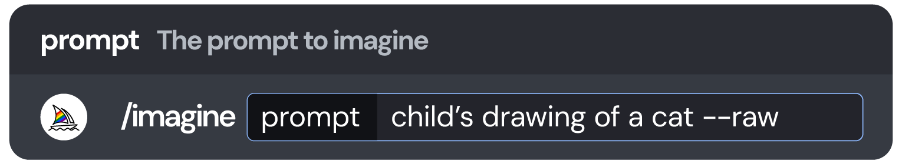

# Raw

> 来源：https://docs.midjourney.com/hc/en-us/articles/32634113811853
> 抓取时间：2026-11-05

---

### Gain more control over your images with Raw.

> For more information about V8.2, see our [Version](https://docs.midjourney.com/hc/en-us/articles/32199405667853) article.

## What is Raw?

In Standard mode, Midjourney automatically adds its own creative touch to your images, which can transform simple prompts into a wide range of artistic styles.

When you switch to Raw, you’re essentially turning off this “auto-pilot.” With simple prompts, you’ll often get more realistic, photo-like images. If you provide more stylistically detailed prompts with Raw, you can really dial in and control the final look of your images.

Raw is compatible with Midjourney [versions](https://docs.midjourney.com/hc/en-us/articles/32199405667853) 5.1 and later.

## Using Raw

**On Web**

**In Discord**

