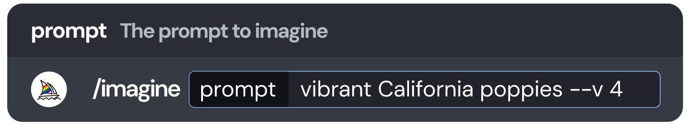

# Version

> 来源：https://docs.midjourney.com/hc/en-us/articles/32199405667853
> 抓取时间：2026-11-05

---

### Explore and switch between Midjourney versions using the version parameter: `--version` or `--v`

## What are Versions?

Think of versions like software updates. When software is updated, it might have better graphics or new features. Similarly, Midjourney versions refer to the different models released over time—each with unique features.

Each version might handle prompts differently, have unique artistic styles, or offer improved image quality.

The current default Midjourney version is V8.2.

## Setting a Version

**On Web**

**In Discord**

## V8.2

V8.2 released as the default version on July 24, 2026. V8.2 is an update focused on aesthetics, image quality, and [Personalization](https://docs.midjourney.com/hc/en-us/articles/32433330574221). It also features the new [Edit Model](https://docs.midjourney.com/hc/en-us/articles/48495453462797), which replaces Omni Reference, Character Reference, and the Retexture tool.

V8.2 images are more creative, bold, sophisticated, and edgy. Personalization "understands" your aesthetic tastes much better, especially on profiles with a large amount of points. Creating Personalization profiles for V8.2 now has a much larger and improved pool of images to choose from.

For more information and tips, see our [Version 8.2 post](https://www.midjourney.com/updates/version-8-2).

## V8.1

V8.1 released on April 14, 2026, and was the default version from June 10 to July 23, 2026. V8.1 is our fastest model so far, with standard jobs rendering about 4–5 times faster than earlier versions. It also does a better job reading your prompt and holding on to small details. For even more prompt adherence, you can turn on [Raw](https://docs.midjourney.com/hc/en-us/articles/32634113811853) to remove default styling.

You may need to unlock your Global V7/V8 [Personalization](https://docs.midjourney.com/hc/en-us/articles/32433330574221-Personalization) Profile to use V8.1.

#### HD Images

V8.1 features HD images, allowing you to generate higher resolution 2K images, without upscaling. You can turn on HD images in the Version section of the settings panel on web, or by using the `--sd` and `--hd` parameters. Using the web "Run batch as HD" button on SD V8.1 images will rerun the seedlocked prompt in HD. HD costs 1.3 minutes of [GPU time](https://docs.midjourney.com/hc/en-us/articles/32016412137741-GPU-Speed-Fast-Relax-Turbo), compared to SD which costs 0.8 minutes of GPU time.

Note: Using any of our inpainting or outpainting tools (Pan, Zoom Out, Edit/Vary Region) on HD images will downscale the resulting images to SD. You can use the Upscale options to return these images to HD resolution.

For more information and tips, see our [V8.1 Alpha post](https://updates.midjourney.com/v8-1-alpha/).

**V8.0 Alpha**

#### Feature Compatibility & Comparison Chart

## V7

V7 was released on April 3, 2025, and was the default version from June 17, 2025 to June 9, 2026.

In V7, text and image prompts are handled with stunning precision, while image quality shines with richer textures and more coherent details—especially in bodies, hands, and objects.

V7 also introduced [Draft Mode](https://docs.midjourney.com/hc/en-us/articles/35577175650957) and [Omni Reference](https://docs.midjourney.com/hc/en-us/articles/36285124473997).

## V6.1

V6.1 was released on July 30, 2024, and was the default version until June 16, 2025. It produces more coherent images with more precise details and textures, and generates images approximately 25% faster than V6.

## V6

V6 was released on December 20, 2023, and was the default version from February 14 to July 30, 2024. V6 has enhanced prompt accuracy for longer inputs, improved coherence and knowledge, and advanced image prompting and remixing capabilities.

## Niji 7

*Niji models are a special series within Midjourney, developed in collaboration with Spellbrush, to focus on Eastern and anime aesthetics and illustrative styles. Niji models have their own dedicated *[*website*](https://nijijourney.com/home)* and *[*Discord server*](https://discord.com/invite/nijijourney)*, providing a tailored experience for anime enthusiasts.*

Niji 7, launched on January 9, 2026, brings a major boost in coherency. Fine details like eyes, reflections, and small background elements are now much clearer. It also follows prompts more closely, which helps with specific designs or repeatable characters. This version is more literal, so broad or “vibey” prompts may not behave the same as before. Niji 7 also introduces a cleaner, flatter look designed to highlight its improved line work. For more details check out the [Niji blog](https://nijijourney.com/blog/niji-7).

For information about older versions, please see our [Legacy Features](https://docs.midjourney.com/hc/en-us/articles/33329788681101) article.
