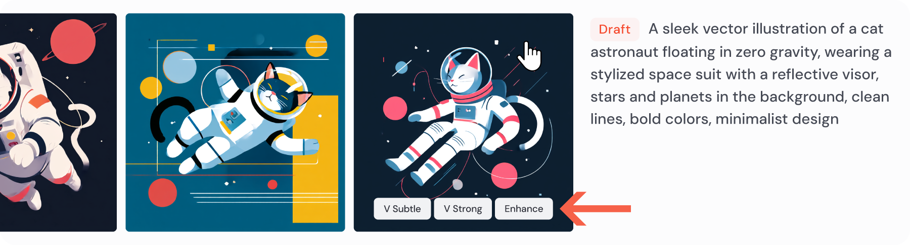
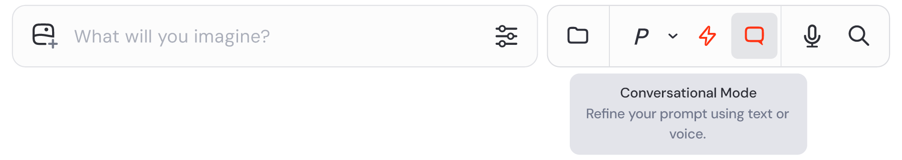

# Draft & Conversational Modes

> 来源：https://docs.midjourney.com/hc/en-us/articles/35577175650957
> 抓取时间：2026-11-05

---

### Turbocharge your creative flow with Draft Mode!

## What is Draft Mode?

Draft mode is a lightning-fast way to prototype images at a lower [GPU cost](https://docs.midjourney.com/hc/en-us/articles/32016412137741). Draft mode images generate faster and use less GPU time, making them great for experimenting and trying out new ideas. It's built for effortless iteration, with the option of using Conversational mode via text or voice to have AI help you write prompts.

Draft mode is compatible with Midjourney [versions](https://docs.midjourney.com/hc/en-us/articles/32199405667853) 7 and 8.1, but it functions differently in each.

## Using Draft Mode

To activate Draft mode, head to your Create page and click the  Draft Mode button next to the Imagine bar. Once activated, any prompts you type into the Imagine bar will run in Draft mode. You can also add `--draft` to any prompt to run it as a draft. To deactivate Draft mode, simply press the button again.

## Draft Mode in V8.1 / V8.2 

A single Draft mode prompt in V8.1 or V8.2 will generate a big batch of 24 images. These Draft images are lower resolution (512 x 512px), and each prompt costs 0.4 minutes of GPU time.

Use the [Vary](https://docs.midjourney.com/hc/en-us/articles/32692978437005-Variations) and [Remix](https://docs.midjourney.com/hc/en-us/articles/32799074515213-Remix) buttons on individual Draft images to regenerate new versions of them in higher resolution, based on your settings (SD or HD).

Note: Draft mode in V8.1 and V8.2 is only available on [midjourney.com](https://www.midjourney.com), it is not currently available in Discord.

## Draft Mode in V7

A Draft mode prompt in V7 will generate 4 images at half the GPU cost of standard V7 prompts.

If you draft an image you like, use the "Enhance" button to regenerate it using a higher [quality](https://docs.midjourney.com/hc/en-us/articles/32176522101773) setting. This will produce a new set of images very similar to your draft image, but using the standard amount of GPU time—just like prompting without Draft mode.

If you really love one of your draft images just as it is, feel free to [upscale](https://docs.midjourney.com/hc/en-us/articles/32804058614669) it! Just click the draft image to open it, and select an upscale option from the Creation Actions menu.

**Video tutorial:** Watch this quick [video tutorial on Draft mode and Conversational mode](https://youtu.be/56X2ISOK-gQ?si=WGWBHxdI7C0OlhRA) below (V7).

<video controls preload="metadata" src="../assets/videos/v_56X2ISOK-gQ.mp4" width="100%"></video>

*视频教程 · 2:36 · 本地文件 `assets/videos/v_56X2ISOK-gQ.mp4`*

## Conversational Mode

Conversational mode allows you to describe your ideas and images in normal, conversational language to an AI that will write prompts for you.

Conversational mode is compatible with Midjourney [version](https://docs.midjourney.com/hc/en-us/articles/32199405667853) 7 and 8.1.

Click the  Conversational mode button in the Imagine bar to activate it.

You can use Conversational mode in two ways:

1. **With Text:** The Imagine bar becomes your space to share ideas with the AI. Just type in your thoughts and press enter.

2. **With Voice:** Prefer talking? Click the microphone  icon. The first time, you might need to let your browser use the microphone. Speak your ideas, and hit the microphone icon again to stop.

You can even use Conversational mode in other languages!

If you want to tweak or explore variations of an image in Conversational mode, refer to specific images by saying "image 1," "image 2," and so on. For example, you can say, "run a variation of image 4."

Keep in mind that you can guide the AI and communicate what you need, but you won't be writing the prompts directly in Conversational mode.

You can use text Conversational mode with or without Draft mode, but voice Conversational mode requires the use of Draft mode.
