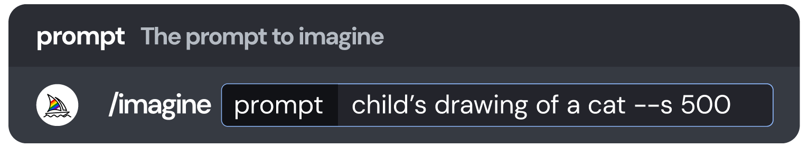

# Stylize

> 来源：https://docs.midjourney.com/hc/en-us/articles/32196176868109
> 抓取时间：2026-11-05

---

### Control the artistic flair in your images with the stylize parameter: `--stylize` or `--s`

> For more information about V8.2, see our [Version](https://docs.midjourney.com/hc/en-us/articles/32199405667853) article.

## What is Stylize?

Think of stylize as a slider that changes how much artistic creativity is applied to your image. With a low stylize setting, it's like asking for an image that follows your prompt very closely—Midjourney sticks to the facts without much extra flair. With a higher stylize setting, it's like giving Midjourney more freedom to interpret your idea. The image might look more artistic and visually interesting, but it could stray from the exact details of your prompt.

So, stylize lets you choose if you want your image to be more literal (based on your prompt) or more creative and artistic.

The default value for stylize is 100, and you can adjust it anywhere between 0 and 1000 with the latest [Midjourney versions](https://docs.midjourney.com/hc/en-us/articles/32199405667853).

**Video tutorial:** Watch this quick [video tutorial on Stylize](https://youtu.be/ieU2Luepk7c?si=pv0ed_lbieoDlUjc) below.

<video controls preload="metadata" src="../assets/videos/v_ieU2Luepk7c.mp4" width="100%"></video>

*视频教程 · 3:28 · 本地文件 `assets/videos/v_ieU2Luepk7c.mp4`*

## Setting the Stylize Value

**On Web**

**In Discord**

