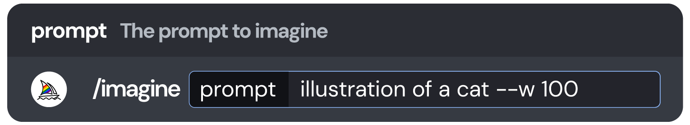

# Weird

> 来源：https://docs.midjourney.com/hc/en-us/articles/32390120435085
> 抓取时间：2026-11-05

---

### Make your images quirky and unconventional with the weird parameter: `--w` or `--weird`

> For more information about V8.2, see our [Version](https://docs.midjourney.com/hc/en-us/articles/32199405667853) article.

## What is Weird?

Weird is a fun tool that spices up your images by adding a touch of the unusual or strange. When you use it, you’re telling Midjourney to take some creative risks.

Weird gives you the power to create images that are more experimental or out-of-the-box, allowing your creative ideas to wander into new, exciting places!

By default, weird is set to 0, but you can add values up to 3000. Keep in mind that weird is an experimental feature, and what's "weird" may change over time. Weird is also not fully compatible with [seeds](https://docs.midjourney.com/hc/en-us/articles/32604356340877).

Weird is compatible with Midjourney [versions](https://docs.midjourney.com/hc/en-us/articles/32199405667853) 5 and later.

## Setting the Weird Value

**On Web**

**In Discord**

