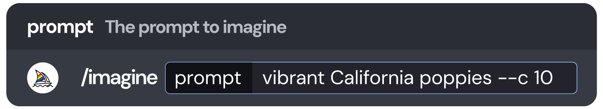

# Chaos / Variety

> 来源：https://docs.midjourney.com/hc/en-us/articles/32099348346765
> 抓取时间：2026-11-05

---

### Add more variety to your image results with the chaos parameter: `--c` or `--chaos`

> For more information about V8.2, see our [Version](https://docs.midjourney.com/hc/en-us/articles/32199405667853) article.

## What is Chaos?

Chaos (also called Variety on midjourney.com) lets you add more variety to the image results you get from each prompt.

By default chaos is set to 0, and Midjourney creates four images based on your prompt. If you want each image to look more different, increase the chaos value.

You can set the chaos value anywhere between 0 and 100, but keep in mind that higher values mean the images can be quite different and may not stick as closely to your prompt, giving you unpredictable results.

**Video tutorial:** Watch this quick [video tutorial on chaos/variety](https://youtu.be/Pnew33tYPd4?si=mDfsKvz_2HgNx0l3) below.

<video controls preload="metadata" src="../assets/videos/v_Pnew33tYPd4.mp4" width="100%"></video>

*视频教程 · 2:41 · 本地文件 `assets/videos/v_Pnew33tYPd4.mp4`*

## Setting the Chaos Value

**On Web**

Add `--c #` to the end of your prompt in the Imagine bar.

You can choose a default Variety setting for all your images in the settings panel. To do this, click the settings  button in the Imagine bar. Once you set it, this will apply to all your future prompts.

**In Discord**

Add `--c #` to the end of your prompt in Discord.

