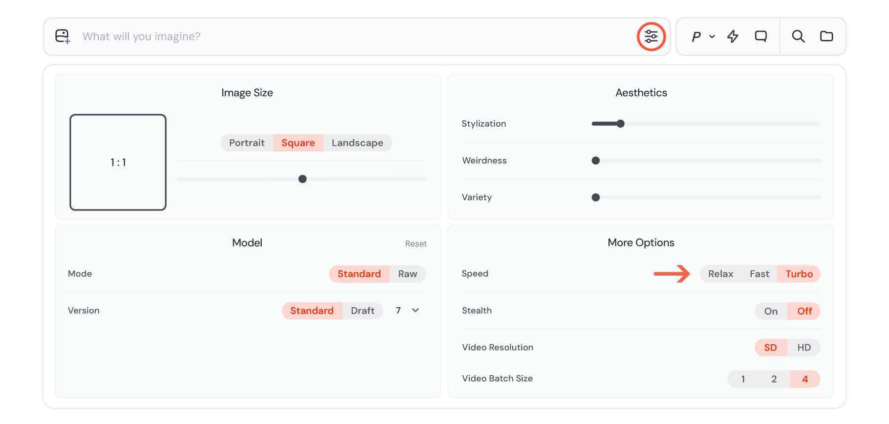

# GPU Speed (Fast, Relax, Turbo)

> 来源：https://docs.midjourney.com/hc/en-us/articles/32016412137741
> 抓取时间：2026-11-05

---

### To change how fast your images and videos are made, adjust your GPU speed.

> Turbo mode is not currently supported in V8.1. For more information about V8.1, see our [Version](https://docs.midjourney.com/hc/en-us/articles/32199405667853) article.

Midjourney uses powerful Graphics Processing Units (GPUs) to handle the prompts you give it and turn them into images and videos. When you subscribe to Midjourney, you're actually buying time to use these GPUs. Think of GPU time like the data you get with a cell phone plan. We offer 3 different GPU speeds to chose from: Fast, Relax, and Turbo.

Note: It's important to understand that GPU time is different from the time you're spending on our website or in Discord, and even from the actual time you wait for your creations. GPU time is only used when Midjourney is actively working to create images/videos for you.

## Fast Mode

When you're in Fast Mode, you're tapping into your Fast time. This is a set amount of GPU time you receive each month with your Midjourney [subscription](https://docs.midjourney.com/hc/en-us/articles/27870484040333). Each time your subscription renews, your Fast time is reset. So, it's smart to use up your Fast time before the month ends, because any unused time doesn't carry over to the next month.

To check how much Fast time you have left, head to your [Manage Subscription](https://www.midjourney.com/account) page and look at the usage details. If you're in Discord, you can use the [info command](https://docs.midjourney.com/hc/en-us/articles/32084927086861) to see your remaining Fast time.

#### How much GPU time does a prompt cost?

Processing one image prompt usually takes about one minute of GPU time, and one video prompt about eight minutes. But remember, different tasks can use more or less. [Upscaling](https://docs.midjourney.com/hc/en-us/articles/32804058614669) images, using nonstandard [aspect ratios](https://docs.midjourney.com/hc/en-us/articles/31894244298125), or older model [versions](https://docs.midjourney.com/hc/en-us/articles/32199405667853) might require more time. Creating [variations](https://docs.midjourney.com/hc/en-us/articles/32692978437005) or using lower [quality](https://docs.midjourney.com/hc/en-us/articles/32176522101773) settings often uses less.

> If you need more Fast time before your plan renews, you can [purchase additional Fast time](https://docs.midjourney.com/hc/en-us/articles/33570952624141) on your [Manage Subscription](https://www.midjourney.com/account) page or you may be able to [complete tasks](https://docs.midjourney.com/hc/en-us/articles/33390759197197) on our website to [earn free Fast time.](https://docs.midjourney.com/hc/en-us/articles/28014817524109)

## Relax Mode

Relax Mode for images is only available to those with Standard, Pro, and Mega Plans. When you switch to Relax Mode, you're using your Relax time, which is unlimited. This means you can create as many images as you want each month without using your Fast time. The tradeoff? Images will take longer to generate compared to Fast Mode.

Relax Mode for SD videos is limited to the Pro and Mega Plans.

#### How Long Does Relax Mode Take?

In Relax Mode, your prompt requests wait in line to be processed as GPUs free up. This means you might experience wait times ranging from 0 to 30 minutes. How long you wait can depend on how much you've used Relax Mode compared to other users. If you use Relax Mode less often, you'll typically have shorter wait times.

#### Limitations

[Permutation](https://docs.midjourney.com/hc/en-us/articles/32761322355597) prompts, the [repeat](https://docs.midjourney.com/hc/en-us/articles/32757107922061) parameter, HD resolution [videos](https://docs.midjourney.com/hc/en-us/articles/37460773864589), and Max Upscale (a legacy [upscaler](https://docs.midjourney.com/hc/en-us/articles/32804058614669)) are not available while using Relax mode. Relax Mode for [videos](https://docs.midjourney.com/hc/en-us/articles/37460773864589) (SD resolution) is only available on the Pro and Mega Plans.

## Turbo Mode

Want your images super fast? Turbo Mode is for you! When you switch to Turbo Mode, you're using your Fast time. This mode taps into a special, high-speed GPU pool that can generate images up to four times faster than Fast Mode.

**Keep in mind that Turbo Mode uses double the Fast time for each image.** You can enjoy Turbo Mode with Midjourney versions 5 and later. If the Turbo GPUs aren’t available or you're on an older version, your job will switch automatically to Fast Mode.

Remember, Turbo Mode is experimental, so its availability and costs might change anytime.

## Switching Speeds

> Your website and Discord settings are synced. This means that if you change your settings in one place, they'll automatically change in the other—including your generation speed. Double-check your settings to make sure they're set the way you want them before you generate images and videos!

**On Web**

**With Settings:** You can choose a default GPU speed for all your images in the settings panel by clicking the settings  button in the Imagine bar. Once you set it, this speed will apply to all your future prompts.

**With Parameters:** To override your default generation speed for a specific prompt, you can add the `--fast`, `--relax`, or `--turbo` [parameter](https://docs.midjourney.com/hc/en-us/articles/32859204029709) at the end of your prompt in the Imagine bar.

**In Discord**

**With Commands:** Use `/relax`, `/fast`, or `/turbo` as a standalone command in Discord to switch between speeds.

**With Settings:** Use the [settings command](https://docs.midjourney.com/hc/en-us/articles/32868982949517) and choose `🐢 Relax Mode` `🐇 Fast Mode` or `⚡ Turbo Mode` from the menu.

**With Parameters:** To override your default speed for a specific prompt, you can add the `--fast`, `--relax`, or `--turbo` [parameter](https://docs.midjourney.com/hc/en-us/articles/32859204029709) at the end.
