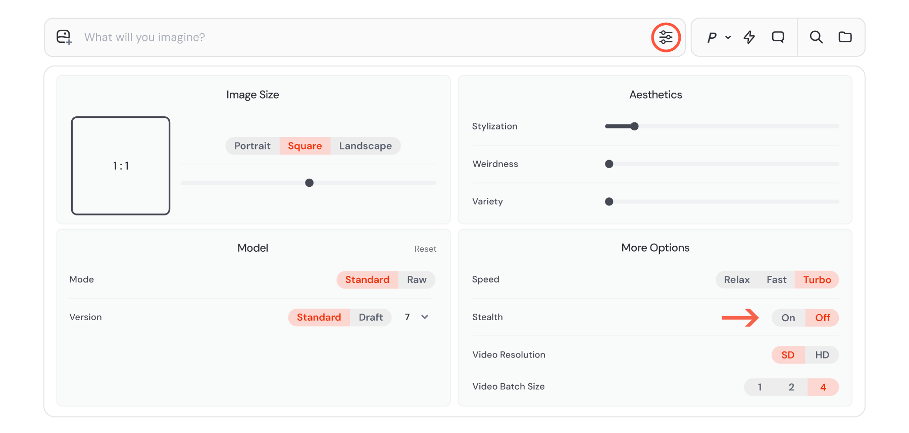
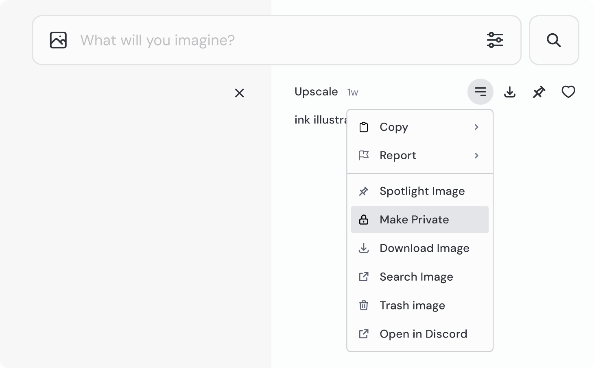
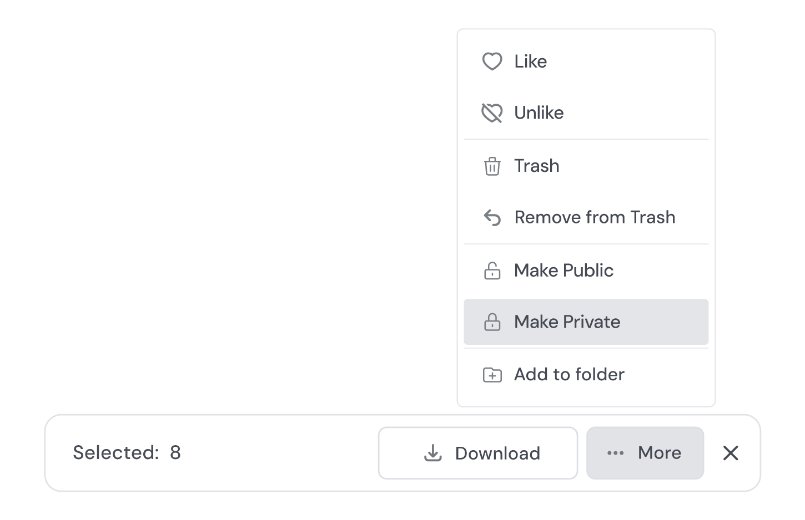

# Stealth Mode

> 来源：https://docs.midjourney.com/hc/en-us/articles/32019750070669
> 抓取时间：2026-11-05

---

### You can manage who sees your creations on the Midjourney website by using Stealth mode.

## What is Stealth Mode?

Stealth mode lets you control who can see your images and videos on the Midjourney website. You can choose which content to make public or keep private.

Important: Even with Stealth mode turned on, any creations made in public channels on Discord are still visible to others. If you want total privacy, use your web [Create page](https://docs.midjourney.com/hc/en-us/articles/33390732264589), generate them in Discord [direct messages](https://docs.midjourney.com/hc/en-us/articles/32637339216013), or work in a [private Discord server](https://docs.midjourney.com/hc/en-us/articles/32637946450445) while using Stealth mode.

Stealth mode is available only to Pro and Mega Plan members. If you cancel or downgrade your subscription, any content you've made private will stay that way on the site.

## Switching to Stealth Mode

> Your website and Discord settings are synced. This means that if you change your settings in one place, they'll automatically change in the other—including Stealth mode. Double-check your settings to make sure they're set the way you want them before you generate images and videos!

**On Web**

**With Settings:** You can turn Stealth mode on or off through the settings panel, which you can access with the settings  button in the Imagine bar. Changing your default mode will apply to all your future prompts but won't affect your existing images.

**With Parameters:** To change your default setting for a specific prompt, just add the `--stealth` or `--public` [parameter](https://docs.midjourney.com/hc/en-us/articles/32859204029709) at the end of your prompt in the Imagine bar.

To see which of your creations are public, visit your Organize page and use the filter checkboxes to select Published images.

**In Discord**

## Make Existing Creations Private

Upgrading to a subscription plan with Stealth mode lets you make private images and videos already generated, even if they were created using a lower-tier plan. But keep in mind, upgrading or setting Stealth mode as your default doesn't automatically make your public creations private, you'll need to manually make them private.

#### Individual Images/Videos

To change the visibility of an individual image or video, click into it from your Create or Organize page and use the options button  located near the prompt text.

#### Multiple Images/Videos

To change multiple images and videos all at once, go to your Organize page. You can click and drag or use shift + click to select multiple items. Once you've selected them, look for the More button in the bulk change pop-up window at the bottom of the screen. This will allow you to make bulk changes easily.

> No, trashing creations and making them private are not the same. Trashed creations may still be found on the Explore page, in ranking, or by using the job ID or creation URL.
