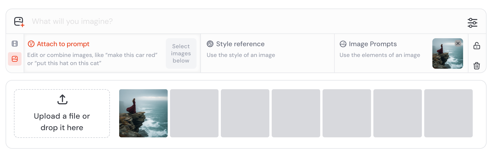
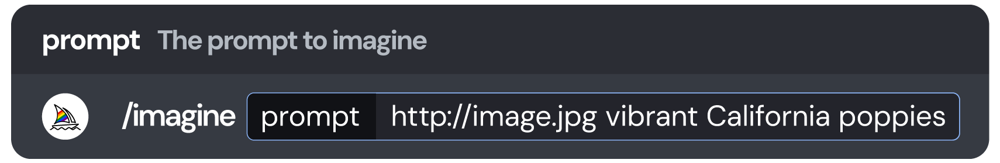

# Image Prompts

> 来源：https://docs.midjourney.com/hc/en-us/articles/32040250122381
> 抓取时间：2026-11-05

---

### Want to influence the content, composition, and colors of your Midjourney creations? Include an image as part of your prompt!

> For more information about V8.2, see our [Version](https://docs.midjourney.com/hc/en-us/articles/32199405667853) article.

There are several ways you can use your own pictures when creating prompts with Midjourney. In this article, we'll focus on Image Prompts, but there are also [Edit Model](https://docs.midjourney.com/hc/en-us/articles/48495453462797) References, [Style References](https://docs.midjourney.com/hc/en-us/articles/32180011136653), and [Moodboards](https://docs.midjourney.com/hc/en-us/articles/39193335040013) using [Personalization](https://docs.midjourney.com/hc/en-us/articles/32433330574221). You can even mix and match to get exactly what you want in your images!

## What are Image Prompts?

Image Prompts let you guide Midjourney by including an image along with your text prompt. Midjourney looks at your image's core elements, and uses it as a source of inspiration for your new and unique image.

#### Three Ways to Use Image Prompts

1. **Single Image Prompt  + Text Prompt**
Choose an image similar to your vision, then add descriptive text. Your text prompt should include everything you want in the final image, rather than instructions for changing the reference image.

2. **Multiple Image Prompts  Without Text Prompt**
Upload two or more images *without* text to blend them together—similar to using the [Blend command in Discord](https://docs.midjourney.com/hc/en-us/articles/32635189884557). This is perfect if you want Midjourney to focus on visual elements.

3. **Multiple Image Prompts  + Text Prompt**
Combine several images with descriptive text for more detailed guidance. Use your text prompt to specify important details not visible in your reference images.

## Using Image Prompts

**On Web**

To add an image to your prompt, start by clicking on the image  icon in the Imagine bar. This opens the images panel, allowing you to upload new images or pick from those you've already uploaded. You can even select multiple images to use in your prompt!

Click your image in the uploads library to automatically add it as an Image Prompt. You can also drag and drop your image into any of the image sections to use it in different ways. To remove your image from the Imagine bar, hover your mouse over it and click the X icon.

If you want to use your images with multiple prompts, click the lock icon  to keep your images pinned to the Imagine bar.

**Image Reference Types:**
 [Edit Model Reference](https://docs.midjourney.com/hc/en-us/articles/48495453462797) (Attach to prompt)
 [Style Reference](https://docs.midjourney.com/hc/en-us/articles/32180011136653)
 Image Prompt
 [Animate](https://docs.midjourney.com/hc/en-us/articles/37460773864589)

**In Discord**

To use Image Prompts in Discord, paste your image URL at the beginning of your text prompt. If you want to use multiple images, separate each URL with a space. To easily use multiple images without a text prompt, check out the [Blend command](https://docs.midjourney.com/hc/en-us/articles/32635189884557).

It's important to ensure that you have a valid image URL, meaning the image should already be online. If your image is stored on your computer or device, you can [host it on Discord](https://docs.midjourney.com/hc/en-us/articles/32558957919117) to generate an image URL.

> Midjourney uses Image Prompts and references as inspiration to guide new creations, not to copy them exactly. If you're looking to make precise changes on your own images, check out the [Editor](https://docs.midjourney.com/hc/en-us/articles/32764383466893).

## Image Weight

If you want more control over how much your Image Prompt affects the final image, try using the image weight parameter `--iw`.

If you don't set an `--iw` value, Midjourney will use the default setting. By choosing a higher weight, your Image Prompt will have a bigger impact on the finished image.

Remember, different [Midjourney versions](https://docs.midjourney.com/hc/en-us/articles/32199405667853) may have different image weight ranges.

**More Information**

Need Help Getting Started?

Getting Started Guide
