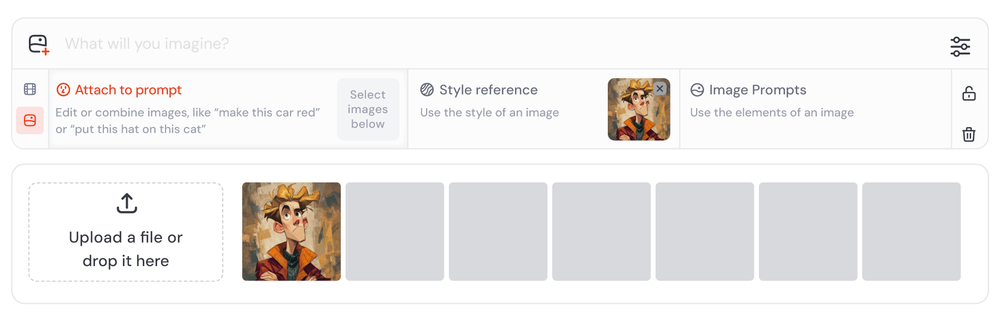
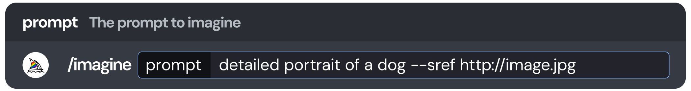

# Style Reference

> 来源：https://docs.midjourney.com/hc/en-us/articles/32180011136653
> 抓取时间：2026-11-05

---

### Want to match the look and feel of another image? You can provide Midjourney with a Style Reference!

> For more information about V8.2, see our [Version](https://docs.midjourney.com/hc/en-us/articles/32199405667853) article.

## What is a Style Reference?

A Style Reference is a way to capture the visual vibe of an existing image and apply it to your new Midjourney creations. It doesn't copy objects or people, just the overall style—like colors, medium, textures, or lighting—helping you achieve a consistent visual theme.

Style References are compatible with Midjourney [versions](https://docs.midjourney.com/hc/en-us/articles/32199405667853) 6 and later.

**Video tutorial:** Watch this quick [video tutorial on Style References](https://youtu.be/tx0DPppldwU?si=05v9J0JLegidPnDs) below.

<video controls preload="metadata" src="../assets/videos/v_tx0DPppldwU.mp4" width="100%"></video>

*视频教程 · 5:04 · 本地文件 `assets/videos/v_tx0DPppldwU.mp4`*

## Using a Style Reference

**On Web**

To add an image to your prompt, start by clicking on the image  icon in the Imagine bar. This opens the images panel, allowing you to upload new images or pick from those you've already uploaded. You can even select multiple images to use in your prompt!

Drag and drop your image from the uploads library into the Style Reference section. To remove your image from the Imagine bar, hover your mouse over it and click the X icon.

If you want to use your images with multiple prompts, click the lock icon  to keep your images pinned to the Imagine bar.

**Image Reference Types:**
 [Animate](https://docs.midjourney.com/hc/en-us/articles/37460773864589)
 [Edit Model Reference](https://docs.midjourney.com/hc/en-us/articles/48495453462797) (Attach to prompt)
 Style Reference
 [Image Prompt](https://docs.midjourney.com/hc/en-us/articles/32040250122381-Image-Prompts)

**In Discord**

## Best Practices

####  Bad Prompt Examples:

 the look of this image but a dog
 copy this style and make a bunny

####  Good Prompt Examples:

 detailed portrait of a dog
 ballpoint pen sketch of a bunny

## Style Weight

The style weight parameter `--sw`, allows you to control how strongly the style of your reference influences your new image. You can set this parameter to any value between 0 and 1000, with the default being `--sw 100`. If using V7, you may notice that style weight has more impact when used with style codes than with images.

Note: `--sw` is not compatible with [Moodboards](https://docs.midjourney.com/hc/en-us/articles/32433330574221).

## Style Reference Codes

Instead of uploading an image as your Style Reference, you can use a Style Reference Code to apply a specific look from the Midjourney internal style library. Each numerical code produces a unique visual style, and can be used by adding `--sref <code>` to the end of your prompt.

Use `--sref random` in your prompt and Midjourney will apply a random style code. After submitting your prompt, "random" converts to a style code.

Once your prompt has a style code, using rerun/reroll or variations keeps the same style code. If you use `--sref random` with a [permutation](https://docs.midjourney.com/hc/en-us/articles/32761322355597), [repeat](https://docs.midjourney.com/hc/en-us/articles/32757107922061), or V8.1 [Draft mode](https://docs.midjourney.com/hc/en-us/articles/35577175650957) prompt, each image will have a different style code.

You can use the `--sw` parameter with style codes to adjust the influence they have on your image. You can also mix style codes by using more than one, and combine images with style codes.

> You cannot create a style code based on an uploaded image. See the instructions above to use an uploaded image as a Style Reference.

## Style Explorer

The Style Explorer is a visual way to discover new style codes and find inspiration for your creations. You can browse style codes, try them instantly, and even save your favorites for later.

1. Open the [Explore Page](https://www.midjourney.com/explore) and click the  **Styles** tab in the top-right corner

2. Use the sorting buttons in the top-left to switch between:
Random style codes to discover new looks
Popular style codes favored by the Midjourney community

3. Use the search bar and type things like "photographic" or "anime" and the fuzzy search will try to show you corresponding style codes

Click any style code to open a gallery of example images that showcase its unique look. From there, you can:

If you find a style code you love, hit the  **Like** button to save it. Your favorites are collected under the **Likes** tab, making it easy to revisit and reuse your go-to style codes whenever inspiration strikes.

Note: Liking style codes does not affect your [Personalization](https://docs.midjourney.com/hc/en-us/articles/32433330574221-Personalization) profiles.

If you're interested in creating your own custom style codes, see our [Style Creator](https://docs.midjourney.com/hc/en-us/articles/41308374558221) article.

**V7 Style Reference Versions**

There are six versions of the Style Reference feature in Midjourney version 7 when using images. Use the `--sv` parameter to choose between them.

`--sv 6` is default.
`--sv 4` is the old V7 sref model (prior to June 16, 2025).

Each version offers a unique way of interpreting and applying your Style Reference, so experiment and see what works best for you!

Note: Sref random and sref codes are only compatible with `--sv 4` and `--sv 6`

**V6 Style Reference Versions**

There are four versions of the Style Reference feature in Midjourney version 6. Use the `--sv` parameter to choose between them. `--sv 4` is default. Each version may offer a unique way of interpreting and applying your Style Reference, so experiment and see what works best for you!

`--sv 1` The original style reference algorithm, more “vibey”
`--sv 2` The second iteration of style references
`--sv 3` An updated version of the more “vibey” `--sv 1`
`--sv 4` An updated version of `--sv 2`

Note: style reference version (`--sv`) is not compatible with [Moodboards](https://docs.midjourney.com/hc/en-us/articles/32433330574221).

**More Information**

Need Help Getting Started?

Getting Started Guide
