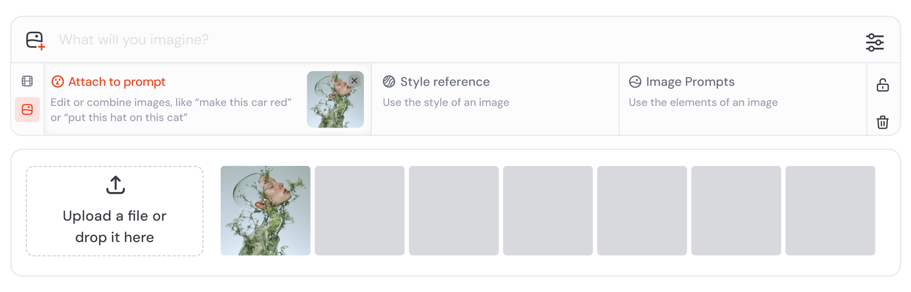
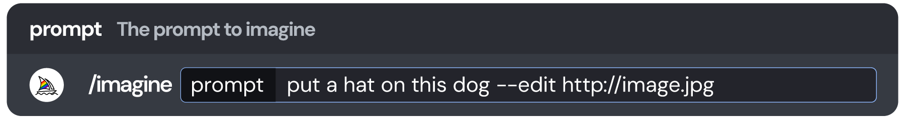

# Edit Model

> 来源：https://docs.midjourney.com/hc/en-us/articles/48495453462797
> 抓取时间：2026-11-05

---

### Want to edit an image — or combine several — just by describing what you want? Use the Edit model to make your vision come to life!

> For more information about V8.2, see our [Version](https://docs.midjourney.com/hc/en-us/articles/32199405667853) article.

## What is the Edit Model?

The Edit model is a new way to create and modify images, and it works in three distinct ways. It allows you to:

1. Make changes to an existing image using written instructions.

2. Generate new images using up to 4 reference images (replacing [Omni Reference](https://docs.midjourney.com/hc/en-us/articles/36285124473997-Omni-Reference) and Character Reference).

3. Use the [Editor](https://docs.midjourney.com/hc/en-us/articles/32764383466893-Editor) to change specific areas of an image (inpainting) and expand its canvas beyond the original frame (outpainting).

The Edit model is compatible with Midjourney [versions](https://docs.midjourney.com/hc/en-us/articles/32199405667853) 8.1 and 8.2. It can also be used with [Image Prompts](https://docs.midjourney.com/hc/en-us/articles/32040250122381-Image-Prompts), [Style References](https://docs.midjourney.com/hc/en-us/articles/32180011136653-Style-Reference), [Moodboards](https://docs.midjourney.com/hc/en-us/articles/39193335040013-Moodboards), [Personalization](https://docs.midjourney.com/hc/en-us/articles/32433330574221-Personalization), and `--hd`.

**Video tutorial:** Watch this quick [video tutorial on the Edit model](https://www.youtube.com/watch?v=JJtNmD5iVCw) below.

<video controls preload="metadata" src="../assets/videos/v_JJtNmD5iVCw.mp4" width="100%"></video>

*视频教程 · 3:09 · 本地文件 `assets/videos/v_JJtNmD5iVCw.mp4`*

> • The Edit model is not currently compatible with `--tile`
> • Edit model image results are not currently compatible with [Remix](https://docs.midjourney.com/hc/en-us/articles/32799074515213).

## Finding the Edit Model

**On Web**

**Imagine Bar**
Start by clicking on the image  icon in the Imagine bar. This opens the images panel, allowing you to upload new images or pick from those you've already uploaded.

Click or drag and drop your image from the uploads library into the **Attach to prompt** section. You can attach up to four images. To remove an image, hover your mouse over it and click the X icon.

Pro tip: If you want to use your images with multiple prompts, click the lock icon  to keep your images pinned to the Imagine bar.

**Creation Actions**
Start by clicking on any image you've made on your Create or Organize page. This will open the image, revealing more options.

Next, look for the "Creation Actions" section where you'll find the Edit options. Click "Quick Edit" to add your image to the Imagine bar, or use "Open Editor" to load the image into the [Editor](https://docs.midjourney.com/hc/en-us/articles/32764383466893-Editor), for targeted changes.

**Editor**
You can use the Edit model within the Editor, which is especially useful if you want to make targeted changes to an image using inpainting and outpainting.

To access the Editor, click  **Edit** from the website navigation menu. For more information, check out our [Editor](https://docs.midjourney.com/hc/en-us/articles/32764383466893-Editor) article.

**In Discord**

## Using the Edit Model

#### Aspect Ratio

The Edit model will automatically try to match the [aspect ratio](https://docs.midjourney.com/hc/en-us/articles/31894244298125) of the first image you upload. To change this, simply include your desired aspect ratio in the prompt using the `--ar` parameter. Your default aspect ratio settings will not automatically apply.

#### Prompting Style

The traditional way to write prompts in Midjourney is to describe the image or scene you are trying to create, without giving directions or instructions. However, with the Edit model, you can now provide specific instructions in your prompts, similar to [Conversational mode](https://docs.midjourney.com/hc/en-us/articles/35577175650957-Draft-Conversational-Modes).

Depending on your exact goals, one or both styles of prompting can be helpful, and we encourage you to experiment and see what works best for you!

*Prompt: make this girl into a real character*

#### Multiple Characters

The Edit model includes the functionality of previous features like Omni Reference and Character Reference, but with the ability to include up to four reference images.

*Prompt: a boy meeting a monster in the wilderness*

Pro tip: If certain features or attributes are getting mixed up between your characters, it can be helpful to combine your characters into a single reference image.

#### Combining Multiple Images

Use up to four reference images to create a new composition that incorporates multiple elements.

*Prompt: make this silver knight ride the horse of fire holding the sword of flowers*

#### Changing Perspective

Shift the perspective and show different views of an object or character using the Edit model.

*Prompts: let's see this image from the front / let's see this image from behind*

#### Retexturing

The Edit model includes the ability to convert an image into a different style. You can use Moodboards, Personalization, and Style References to help guide the new look.

*Prompt: hand drawn pencil sketch of this image --sref 2708276657*

Pro tip: We recommend describing the style in your prompt when using Style References and Moodboards to help "activate" the aesthetic more consistently.

## Using Raw

For more precise control of your Edit model creations, using the `--raw` parameter in your prompts can be helpful.

When you add `--raw`, it reduces the extra creative flair the Midjourney usually adds, allowing your prompt text to have more influence on the outcome.

Need Help Getting Started?

Getting Started Guide
