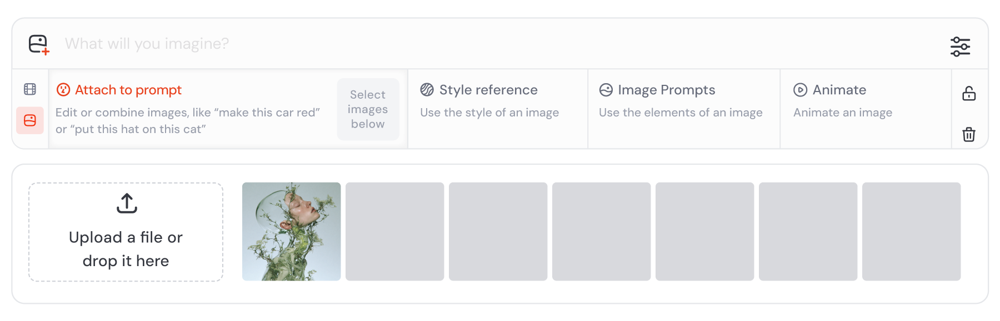
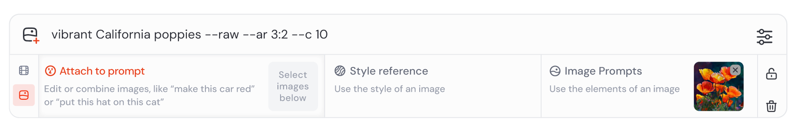
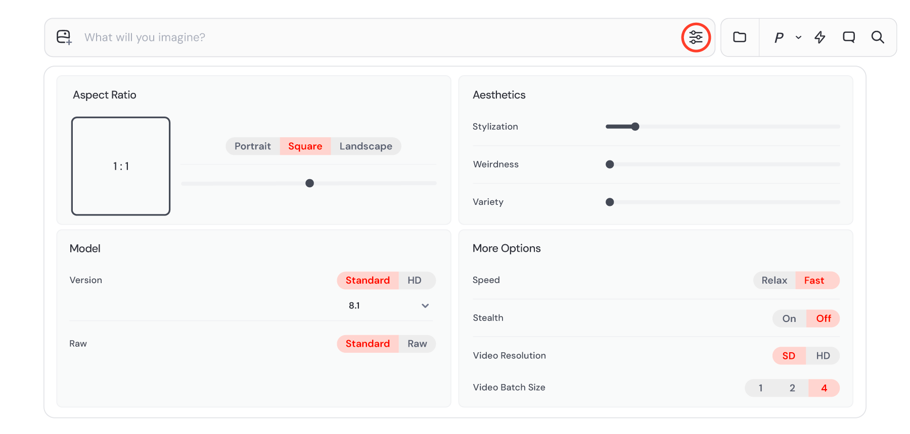
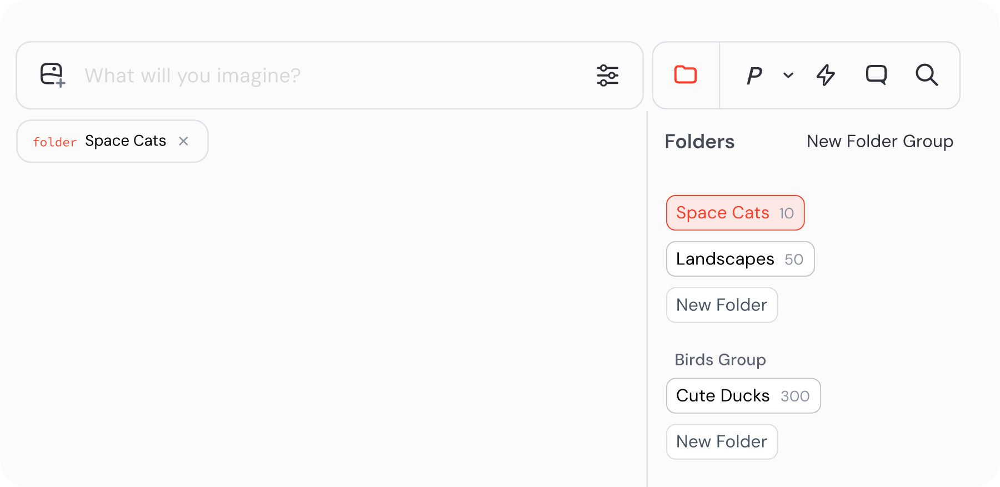
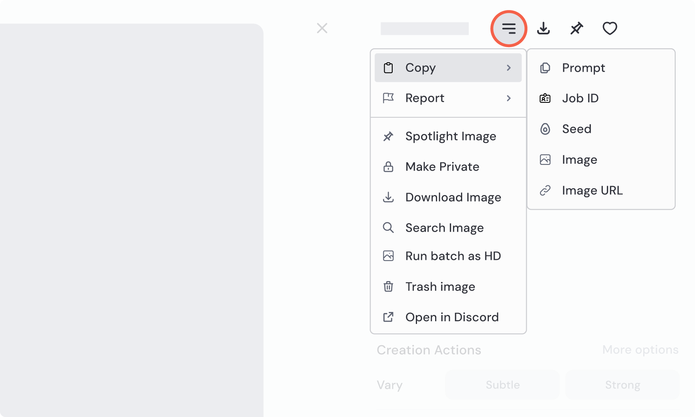

# Creating on Web

> 来源：https://docs.midjourney.com/hc/en-us/articles/33390732264589
> 抓取时间：2026-11-05

---

### Unleash your creativity on the Create page!

Welcome to the [Create page](https://www.midjourney.com/imagine) on midjourney.com, your hub for generating amazing images! While you can use the Imagine bar on many pages, the Create page is where you can watch your images come to life right in front of your eyes.

## Imagine Bar

The Imagine bar is where you type your prompts. Hit the send button or press enter on your keyboard, and your images will start generating. You'll find several helpful tools in the Imagine bar:

 Add or upload images to your prompt
 Adjust your default settings

Next to the Imagine bar you'll find buttons for  [folders](https://docs.midjourney.com/hc/en-us/articles/34580542725645), [Personalization](https://docs.midjourney.com/hc/en-us/articles/32433330574221),  [Conversational mode](https://docs.midjourney.com/hc/en-us/articles/35577175650957), and  searching your prompts.

> Hold Ctrl (or Cmd on Mac) and hit Enter. This runs your prompt and keeps the text in the Imagine bar, so you can easily use the prompt again.

#### Images Menu

Click the image  icon, and you'll get instant access to your images menu. This is your go-to spot for uploading new images to Midjourney or picking from your uploads library to enhance your prompt.

Note: The maximum image file size you can upload to Midjourney is 10MB.

Drag an image from your uploads library into the Imagine bar and drop it into your desired section:

Once an image is added to your prompt, you can use the toggle buttons in the Imagine bar to switch between using the image to generate videos  or still images .

Hover over any image in your uploads library and you'll see a button with three dots. Click it to reveal these options:

When you open the images menu, two extra buttons appear on the Imagine bar.

#### Settings Menu

When you click the  settings icon, you can adjust the default settings that will automatically apply to all your prompts.

- Choose between Standard (SD) or HD size images, and your default [Midjourney version](https://docs.midjourney.com/hc/en-us/articles/32199405667853) for generating images.

- Toggle [Raw](https://docs.midjourney.com/hc/en-us/articles/32634113811853) on or off for different image effects.

- Play with [stylization](https://docs.midjourney.com/hc/en-us/articles/32196176868109) to influence how artistically your images are created.

- Adjust [weirdness](https://docs.midjourney.com/hc/en-us/articles/32390120435085) to add unique quirks.

- Control [variety](https://docs.midjourney.com/hc/en-us/articles/32099348346765) for more diverse outputs.

- Select your default [GPU speed](https://docs.midjourney.com/hc/en-us/articles/32016412137741).

- Activate [Stealth mode](https://docs.midjourney.com/hc/en-us/articles/32019750070669) if your plan allows, keeping your creations private.

- Switch between SD and HD [resolution videos](https://docs.midjourney.com/hc/en-us/articles/37460773864589) (if your plan allows).

- Adjust your video batch size.

## Creation Feed

The central feature of the Create page is the creation feed. Here, you can watch your images generate in real-time and revisit all your finished creations.

When you hover your mouse over any image in the feed, shortcut buttons pop up that let you quickly  trash the image,  like the image, create [subtle or strong variations](https://docs.midjourney.com/hc/en-us/articles/32692978437005) of that image, or use it to create a [video](https://docs.midjourney.com/hc/en-us/articles/37460773864589).

To the right of the images, you'll see the [prompt text](https://docs.midjourney.com/hc/en-us/articles/32023408776205), [parameters](https://docs.midjourney.com/hc/en-us/articles/32859204029709), and reference images that were used to generate your images. Hover over this section to access more shortcut buttons.

With these, you can use the prompt in the  [Style Creator](https://docs.midjourney.com/hc/en-us/articles/41308374558221),  Run batch as HD if you originally used SD,  rerun the same prompt immediately,  use the prompt text and images for a new creation,  trash images from your feed (with the option to remove from trash on your [Organize page](https://docs.midjourney.com/hc/en-us/articles/33329462451469)), or explore  more options.

## Creating in Folders

When you're on the Create page, you'll see a folder button right next to the search bar at the top. Clicking this reveals all your folders and folder groups.

If you click a folder to open it, you'll see a dedicated creation space just for that folder, and you can generate images directly inside it!

Ready to leave a folder? Just click the X in the folder button next to the search bar.

For more information about folders, check out our [Using Folders](https://docs.midjourney.com/hc/en-us/articles/34580542725645) article.

## More Image Options

When you click on an image from your creation feed it will open fullscreen, giving you more options and tools.

At the top, near the prompt text, you'll find a toolbar packed with useful features.

The More Options  button lets you copy important details like the [prompt](https://docs.midjourney.com/hc/en-us/articles/32023408776205), [Job ID](https://docs.midjourney.com/hc/en-us/articles/32635695384461), [seed](https://docs.midjourney.com/hc/en-us/articles/32604356340877), image, or image URL. You can report any image that violates our [Community Guidelines](https://docs.midjourney.com/hc/en-us/articles/32013696484109), choose to [make it private or public](https://docs.midjourney.com/hc/en-us/articles/32019750070669), download, search similar images, run the prompt as HD, trash it, and even open it in Discord (if it was created there).

Next to this, you'll find icons to  download the image,  spotlight it on your profile, and mark your favorites with a  like.

Above the Creation Actions, there's a folder  icon. If your image is already in a folder, you'll see the folder name right there. If not, you can click the folder icon to quickly add the image to a folder.

In the Creation Actions section, you can further tweak your images and continue working with them. For a full breakdown of all these tools and features, check out our [Modifying Your Creations](https://docs.midjourney.com/hc/en-us/articles/33329329805581) article.
