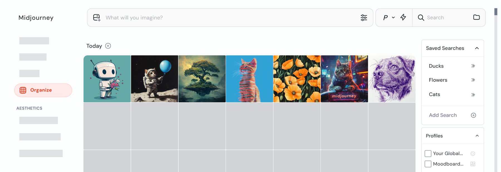
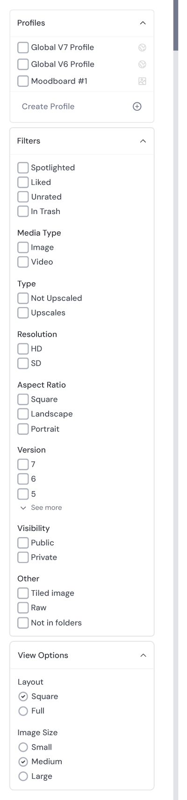
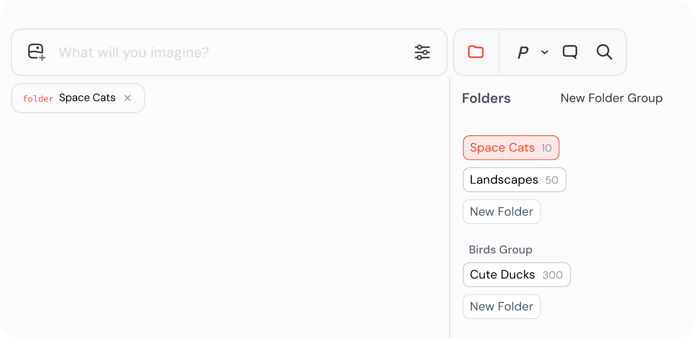
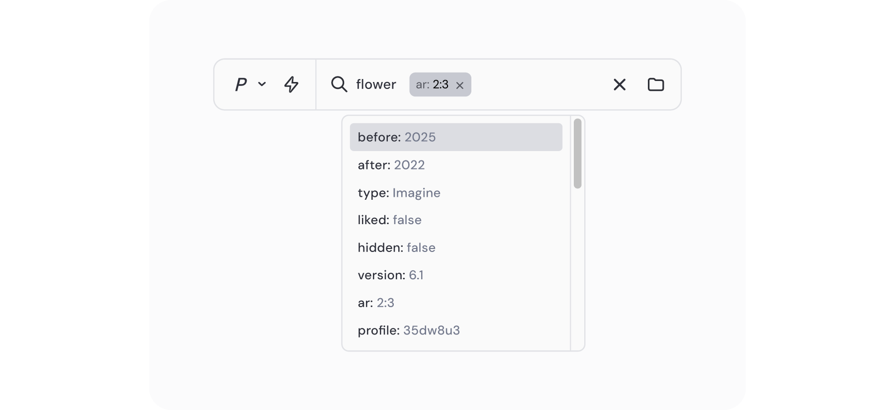
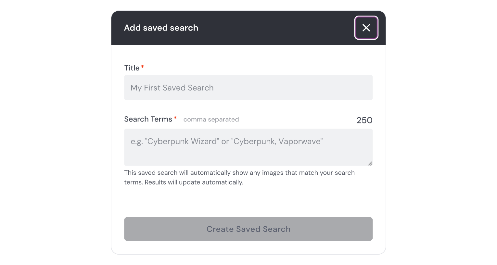

# Organizing Your Creations

> 来源：https://docs.midjourney.com/hc/en-us/articles/33329462451469
> 抓取时间：2026-11-05

---

### Easily manage all your Midjourney creations with the tools and features on your Organize page!

Welcome to the [Organize page](https://www.midjourney.com/archive) on midjourney.com, your centralized hub for managing all your creations!

**Video tutorial:** Watch this quick [video tutorial on organizing your creations](https://youtu.be/jk2Unt9LEC0?si=JNd-YIglglwCW1py) below.

<video controls preload="metadata" src="../assets/videos/v_jk2Unt9LEC0.mp4" width="100%"></video>

*视频教程 · 3:29 · 本地文件 `assets/videos/v_jk2Unt9LEC0.mp4`*

## Filters

On the right side of the page you'll find a toolbar with a variety of options you can use to filter your images. Selecting filters will temporarily hide all other creations that don't match your filters.

> If it seems like some of your images are missing, it might be because a filter is applied. To view all your images again, make sure to uncheck all filter boxes.

#### View Options

These let you customize the look and layout of your Organize page

#### Timeline Bar

Next to the toolbar, you'll notice a thin gray bar resembling a scroll bar. Hovering over it reveals a timeline displaying the specific days you've generated images. Click on any date to jump straight to images created on that day.

## Folders

Just like on your computer, Folders let you neatly organize your images. But here's the fun part: you can now create images directly inside them!

Click the Folder icon next to the Imagine bar to view your folders, create new ones, or create Folder Groups. Give your folders unique names and drag and drop images into them. You can also drag folders into different Folder Groups.

When you enter a prompt in the Imagine bar with a folder open, the results will appear right inside the folder.

The image feed of your folder will appear differently depending on whether you are viewing it from the Create page or the Organize page.

For more information, check out our [Using Folders](https://docs.midjourney.com/hc/en-us/articles/34580542725645) article.

## Searching Your Images

**Search**

On the Organize and Create pages, there's a search bar at the top designed just for your personal image collection.

While other parts of midjourney.com allow you to search images from other users, this search feature focuses on your own creations.

You can search by using words or phrases from your prompt text, as well as specific attributes, like parameters, individual reference images, Personalization profiles, and more.

Scroll through the list of attributes and click to add them to the search bar. Combining prompt text and multiple attributes allows you to narrow down your search and quickly find the images you're looking for.

**Saved Searches**

Saved Searches (previously called Smart Folders) help you organize your images in a very easy way. With these searches, you don't need to add or remove images manually—everything sorts itself automatically based on the terms you provide.

When you set up a Saved Search, only prompts that include all your search terms will appear. It doesn't matter what order the terms are in. For example, if you add "cat dog" you'll get images where both words are used in the prompt.

If you want results for either word, just separate them with a comma. Keep in mind that Saved Searches will also find part of a word. So if you add "cat" you'll get results including "catapult" too.

## Bulk Actions

Easily select multiple images at once by clicking and dragging or using shift + click. You can also select all the images generated on a single day by clicking the plus + icon next to the date.

After selecting, a bulk actions pop-up will appear at the bottom of your screen. This pop-up shows the number of images selected and presents several action options.

You can download images directly, or click the More button for additional actions such as liking or unliking, adding or removing from trash, [making private or public](https://docs.midjourney.com/hc/en-us/articles/32019750070669), and adding or removing from folders.

## Trash

If you want to clean up your workspace you can use the  trash feature to remove creations you no longer need. Here's how it works:

When you trash a creation, it won't be visible on your Create or Organize pages, and it won't show up in the Archive tab of your [Profile page](https://docs.midjourney.com/hc/en-us/articles/41117938447629). If you change your mind, you can still find trashed creations by checking the In Trash filter on your Organize page and use the Remove from Trash option to bring them back.

Important: Trashed creations are not [private](https://docs.midjourney.com/hc/en-us/articles/32019750070669). Others might still find them on the Explore page, in rating, or see them if they have the Job ID or creation URL.

To trash creations in Discord, simply use the ❌ emoji reaction. For more details, take a look at our Discord Overview article.

Trashing creations does not delete them. You cannot delete individual creations, but if you're interested in permanently removing all images, videos, and your account data, please visit our [Data Deletion and Privacy FAQ](https://docs.midjourney.com/hc/en-us/articles/32084462534541) page.
