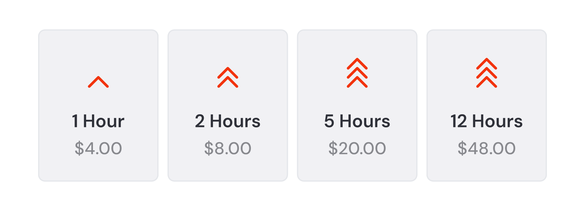

# Purchasing Extra Fast Time

> 来源：https://docs.midjourney.com/hc/en-us/articles/33570952624141
> 抓取时间：2026-11-05

---

If you run out of Fast time before your subscription renews, you can easily purchase more to continue creating without delays.

1. **Visit the Manage Subscription Page:** Log in to midjourney.com and head over to the [Manage Subscription Page](https://www.midjourney.com/account). This is where you can find all the details about your plan and purchase extra Fast time.

2. **Purchase Additional Hours:** Click the "Buy more Fast hours" button and select the amount of Fast time you wish to add. Keep in mind, these purchased hours come with a 60-day expiration, so plan accordingly.

3. **Active Subscription Needed:** To use purchased Fast time, you must have an active subscription. If your subscription lapses, the extra Fast time won't be available unless you renew your plan.

4. **Non-Refundable:** Once you've purchased the additional Fast time, it cannot be refunded.

> You may also be able to [earn free Fast time](https://docs.midjourney.com/hc/en-us/articles/28014817524109) by [completing tasks](https://docs.midjourney.com/hc/en-us/articles/33390759197197) on our website.
