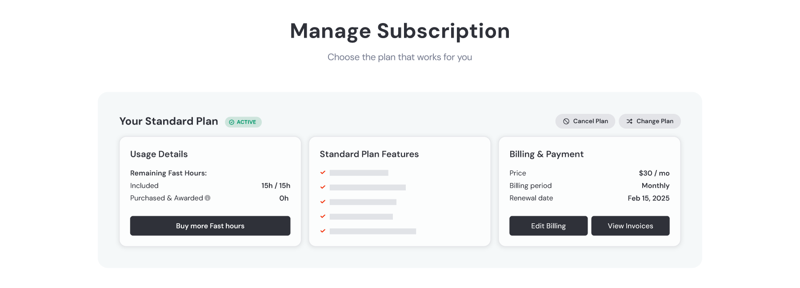

# Managing Your Subscription

> 来源：https://docs.midjourney.com/hc/en-us/articles/28014179406861
> 抓取时间：2026-11-05

---

To manage your Midjourney image generation subscription, simply log in to midjourney.com.

For help logging in, see our [Logging In & Connecting Accounts](https://docs.midjourney.com/hc/en-us/articles/33390994570509) article.

If you're looking to access your magazine subscription instead, please refer to our [Managing Your Magazine Subscription](https://docs.midjourney.com/hc/en-us/articles/27870410169997) article for assistance.

Once you're logged in at midjourney.com, head over to your [Manage Subscription Page](https://www.midjourney.com/account). Here’s what you can do:

