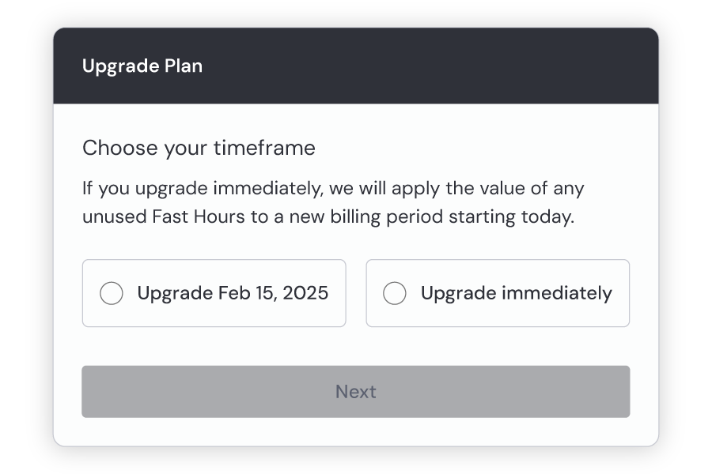

# Upgrading or Downgrading Your Plan

> 来源：https://docs.midjourney.com/hc/en-us/articles/27870428114317
> 抓取时间：2026-11-05

---

Need to adjust your Midjourney plan? You can easily upgrade or downgrade from the [Manage Subscription Page](https://www.midjourney.com/account) on midjourney.com. If you're not logged in yet, be sure to log in first. Then, scroll down past your current subscription details to view other available plans.

Use the "Upgrade Plan" or "Downgrade Plan" button under the new plan you'd like to switch to.

> If you're switching from a yearly plan to an upgraded monthly plan, the website won’t allow an immediate change. Please [contact our billing support team](https://docs.midjourney.com/hc/en-us/articles/32638309968141) for assistance.

**Upgrading**

When you move to a higher-tier plan, you can choose to upgrade immediately or wait until your regular renewal date.

If you upgrade right away, you'll receive a discount based on any unused Fast time from your current plan. If all your Fast time is used up, the new plan will be at full price.

Your subscription will reset immediately, granting you all the benefits of the new plan, including Fast time, and setting your next renewal one month (or one year for yearly plans) from your upgrade date.

Some payment methods and banks won't allow you to upgrade. If you're having any trouble, please [contact billing support](https://docs.midjourney.com/hc/en-us/articles/32638309968141) for assistance.

**Downgrading**

If you decide to switch to a lower-tier plan, the change will take effect at your next renewal, not immediately. Please note that downgrading won't [refund your current plan](https://docs.midjourney.com/hc/en-us/articles/25386088618253).
