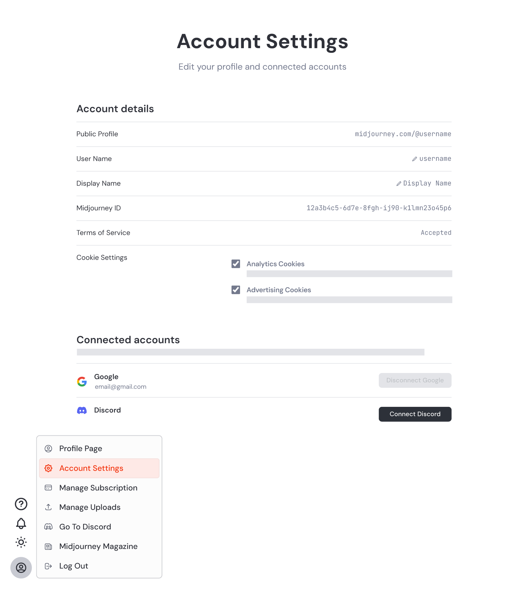

# Using Midjourney in Discord

> 来源：https://docs.midjourney.com/hc/en-us/articles/31541509949069
> 抓取时间：2026-11-05

---

All our [subscription plans](https://docs.midjourney.com/hc/en-us/articles/27870484040333) allow you to use Midjourney both on our website and in Discord. But if you want to make images in Discord, you will need to have a Discord account connected to your Midjourney account. You can do this on your [Account Settings Page](https://www.midjourney.com/profile-settings) on midjourney.com

> You will not be able to connect a Discord account to your current subscription if that Discord account has been used in the past to make images with Midjourney. For more information see our [Logging In & Connecting Accounts](https://docs.midjourney.com/hc/en-us/articles/33390994570509) article.

Use the "Connect Discord" button and you'll be prompted to log into your Discord account and Authorize the connection to Midjourney.

Important: Double-check the email address associated with your Discord account. Entering an email that isn't linked to a Discord account will prompt Discord to take you through the steps of creating a new account. This could lead to complications if you already have an account. Before clicking "Authorize," double-check that your correct Discord username is shown at the top of the popup. If the username is incorrect, use the "Not you?" link.

Once your Discord account is connected, you'll see your login email and Discord username displayed on your Manage Profile page, and you'll be able to generate images in Discord.

#### Disconnecting Accounts

Accounts can only be disconnected by our billing support team. If you need help with this, please [reach out to billing support](https://docs.midjourney.com/hc/en-us/articles/32638309968141). You may be required to verify your account ownership before your login method can be disconnected. Your account must have one method connected at all times, so make sure you have a secondary method already connected before contacting support.
