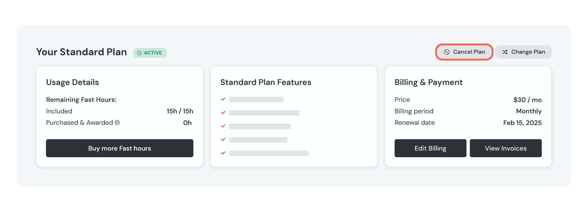

# Turning Off Automatic Renewals

> 来源：https://docs.midjourney.com/hc/en-us/articles/27868888211213
> 抓取时间：2026-11-05

---

All Midjourney subscriptions are set to renew automatically. If you'd prefer not to continue your subscription, you can cancel it via your [Manage Subscription Page](https://www.midjourney.com/account) on midjourney.com. Be sure to log in first if you’re not already.

Once you cancel, you'll still enjoy your current plan’s features and any remaining GPU time until your subscription period ends. However, the plan won't automatically renew at the end of your billing period. Remember, each time you subscribe, you'll need to cancel before renewal if you don't want it to auto-renew—disabling automatic renewals entirely isn't an option.

Canceling comes without penalties, and all your images created with Midjourney will remain saved in your account. You can access them anytime on midjourney.com, even without an active subscription.

