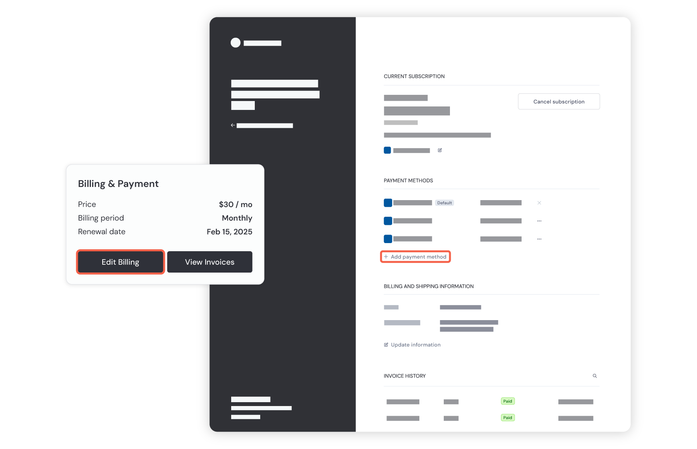

# Editing Your Payment Information

> 来源：https://docs.midjourney.com/hc/en-us/articles/25385791792781
> 抓取时间：2026-11-05

---

## Active Subscription

To review or update your payment details on an active subscription, log in to midjourney.com and go to your [Manage Subscription Page](https://www.midjourney.com/account).

From there, click the **Edit Billing** button. This opens your billing portal in a new window. Inside the portal, you can add new card details by clicking **+ Add payment method**.

Click the **...** (ellipsis) button to set a card as your default payment method.

If you need to delete a payment method, use the **X** button, but remember you must keep at least one payment method on file as long as your subscription is active.

For smooth transactions, ensure your billing address matches the address on file with your credit card issuer. This helps avoid any [unsuccessful payments](https://docs.midjourney.com/hc/en-us/articles/27868801964045).

## Inactive Subscription

If your subscription has ended, you won't see the **Edit Billing** button on your [Manage Subscription Page](https://www.midjourney.com/account). Instead, enter your email address [here](https://billing.stripe.com/p/login/aEUdRA5Wc8t25a03cc). You will receive an email with a link to access your billing portal within a few minutes. Make sure to check your spam folder if you don't receive it right away.

Please note, if you also have a subscription to Midjourney Magazine using the same email address, the form might send you a link to your magazine subscription billing portal instead. If this occurs, or if you encounter any other issues accessing your billing history, please [reach out to billing support](https://docs.midjourney.com/hc/en-us/articles/32638309968141) for assistance.
