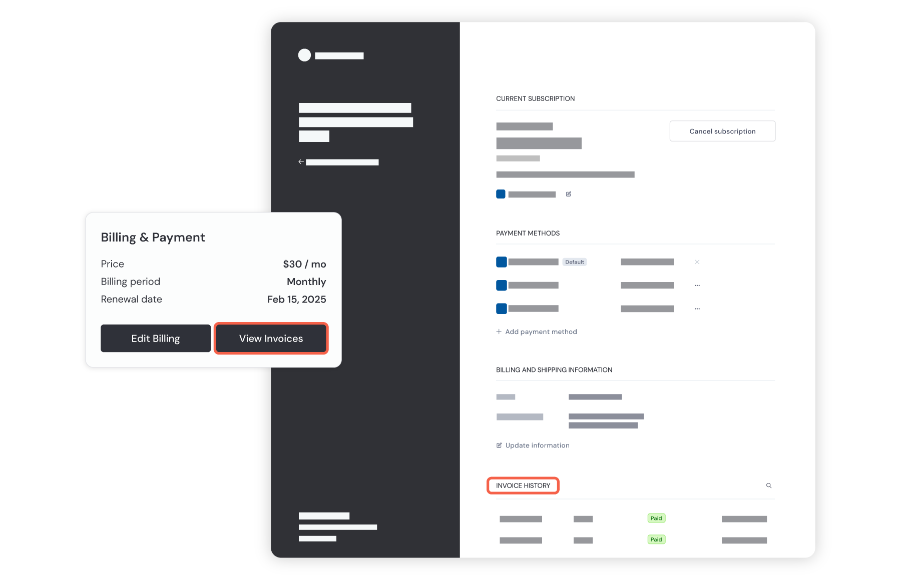

# Viewing Your Payment History

> 来源：https://docs.midjourney.com/hc/en-us/articles/27868885185293
> 抓取时间：2026-11-05

---

> All your invoices and receipts are automatically emailed to the billing email address on file, so you might also find them in your inbox.

## Active Subscription

If you have an active subscription, accessing your billing history is straightforward. Log in to midjourney.com and navigate to the [Manage Subscription Page](https://www.midjourney.com/account). Once there, click the **View Invoices** button to open your billing portal in a new window. At the bottom of this page, you’ll find your Invoice History, where you can click on any invoice to view it.

## Inactive Subscription

If your subscription has ended, you won't see a **View Invoices** button on your Manage Subscription Page. Instead, enter your email address [here](https://billing.stripe.com/p/login/aEUdRA5Wc8t25a03cc). You will receive an email with a link to access your billing portal within a few minutes. Make sure to check your spam folder if you don't receive it right away.

Please note, if you also have a subscription to Midjourney Magazine using the same email address, the form might send you a link to your magazine subscription billing portal instead. If this occurs, or if you encounter any other issues accessing your billing history, please [reach out to billing support](https://docs.midjourney.com/hc/en-us/articles/32638309968141) for assistance.
