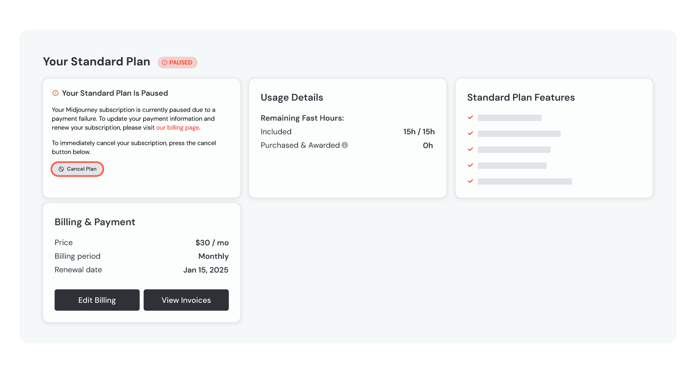

# Fixing a Paused Plan

> 来源：https://docs.midjourney.com/hc/en-us/articles/27868802467853
> 抓取时间：2026-11-05

---

If your subscription doesn't renew because of a payment failure, your plan will be marked as "Paused". This means that the renewal payment didn't go through successfully.

You should receive an email notifying you that the payment attempt was unsuccessful. Our system automatically retries the payment multiple times over several days. However, if none of these attempts work, your subscription will be automatically canceled.

> When a payment is declined, you will often see a pending transaction in your bank account. This is normal, and will go away automatically. It does not mean the payment was successful. When your payment is successful you will always receive an email from Midjourney with your receipt and invoice.

#### How to Fix a Paused Plan:

1. To immediately stop the payment attempts, visit your [Manage Subscription Page](https://www.midjourney.com/account) (make sure you're logged in) and cancel the paused plan. Once canceled, you can re-subscribe from the same page.

2. To update your payment information, visit your [Manage Subscription Page](https://www.midjourney.com/account) (make sure you're logged in) and use the **Edit Billing** button.

For more details on why your payment might not have gone through, see our [Unsuccessful Payments](https://docs.midjourney.com/hc/en-us/articles/27868801964045) article. If you're still experiencing payment issues, please [contact billing support](https://docs.midjourney.com/hc/en-us/articles/32638309968141) for further assistance.

