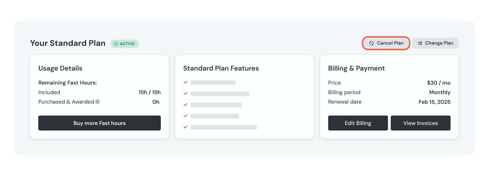

# Canceling Your Subscription

> 来源：https://docs.midjourney.com/hc/en-us/articles/25384024738573
> 抓取时间：2026-11-05

---

You can cancel your Midjourney subscription at any time by going to your [Manage Subscription Page](https://www.midjourney.com/account) and clicking the **Cancel Plan** button.

Your cancellation will become effective at the end of your current billing cycle, and you'll still have access to all of your subscription features—including any remaining Fast time—until then.

> Canceling your subscription does not delete your generated images or account history. Any [private images](https://docs.midjourney.com/hc/en-us/articles/32019750070669) you have will stay private. You can choose to resubscribe at any time.

If you have an upgrade or downgrade scheduled, make sure to cancel that change first by using the **Cancel Change** button before you proceed with canceling your subscription.

