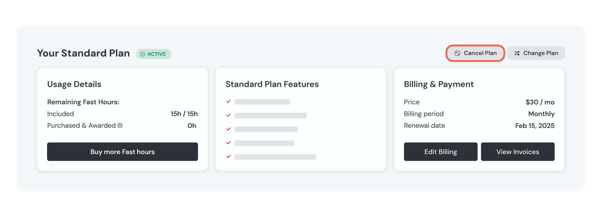

# Requesting a Refund

> 来源：https://docs.midjourney.com/hc/en-us/articles/25386088618253
> 抓取时间：2026-11-05

---

> You're eligible for a refund only if you've used less than 20 GPU minutes throughout the lifetime of your account. This includes both Fast/Turbo and Relax time.

If you qualify for a refund, you'll automatically see the option to request one when you [cancel your subscription](https://docs.midjourney.com/hc/en-us/articles/25384024738573). If you don't see the refund option, we're unable to provide a refund.

Refund eligibility does not apply if your account is suspended or terminated due to a violation of our [Terms of Service](https://docs.midjourney.com/hc/en-us/articles/32083055291277) or [Community Guidelines](https://docs.midjourney.com/hc/en-us/articles/32013696484109).

Refund processing may take up to 10 business days, depending on your bank's processing times, but you'll receive a refund confirmation email from Midjourney within a few minutes.

If you encounter any error messages, wait an hour and try again—your renewal payment might still be processing. If the issue persists, [contact billing support](https://docs.midjourney.com/hc/en-us/articles/32638309968141) for assistance.

