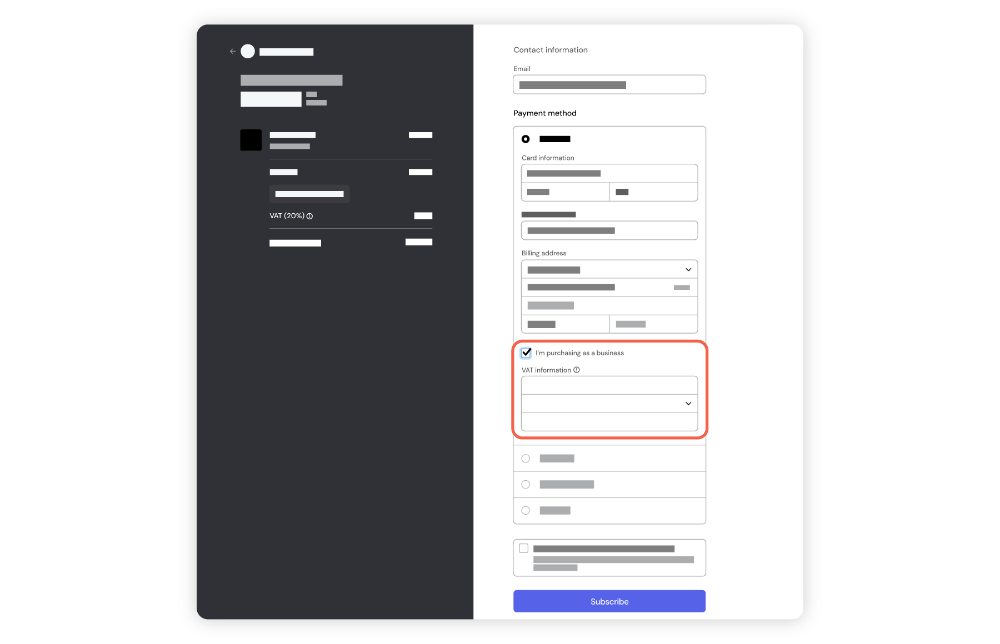

# Setting Your Organization's Tax Status (VAT & Tax Exemptions)

> 来源：https://docs.midjourney.com/hc/en-us/articles/27868838932621
> 抓取时间：2026-11-05

---

> This article is for Midjourney subscribers from organizations that need to input VAT information or apply for a tax exemption. If you're a non-corporate subscriber, refer to our other article on [how taxes are determined for your subscription](https://docs.midjourney.com/hc/en-us/articles/27868801261325).

## When Subscribing

During the checkout process, click the "I'm purchasing as a business" checkbox that will appear after you enter your payment and address information, if taxes apply.

This will reveal fields for entering your tax ID—such as an EIN in the United States, a VAT number, or other tax ID. This information will appear automatically on future invoices.

Note: Please ensure you select the correct country and enter the correct tax ID for international purchases (if applicable).

Our payment processor will try to validate your tax status and apply any eligible exemptions. If the option doesn’t appear, or if validation fails, you can [contact billing support](https://docs.midjourney.com/hc/en-us/articles/32638309968141) after subscribing to update your account and refund any taxes charged.

## After Subscribing

> Billing support cannot alter past invoices, but your updated information will show on future invoices.

You can add a tax ID to your account after subscribing by clicking the "Edit Billing" button on your [Manage Subscription Page](https://www.midjourney.com/account) on midjourney.com. From there, use the "Update Information" link under "Billing and Shipping Information."

If you need assistance adding your tax ID to your account or requesting a refund for taxes already paid, please [contact billing support](https://docs.midjourney.com/hc/en-us/articles/32638309968141) with the following details:

Ensure your subscription’s billing information matches your tax documentation. Once we confirm your tax status, we’ll update your account and refund any taxes paid for the current calendar year, if eligible.

## Removing & Editing Your Tax ID

If you need to remove or fix your tax ID, follow these steps:

1. **Access Your Stripe Billing Portal:** Follow the instructions on our [Editing Your Payment Information](https://docs.midjourney.com/hc/en-us/articles/25385791792781) article to access your Midjourney billing profile and details in Stripe.

2. **Update Your Billing Information:** Once in the portal, look for the "Billing and Shipping Information" section. Click on the link that says “Update Information.”

3. **Clear Your Tax ID:** Navigate to the VAT/tax ID section and click the X next to the Tax ID field so that it’s completely removed. Save your changes to update your information.

4. **Refresh Your Account:** Return to your [Manage Subscription Page](https://www.midjourney.com/account) on midjourney.com and refresh the page.

Need Help Creating Corporate Accounts?

Group Plans & Corporate Billing
